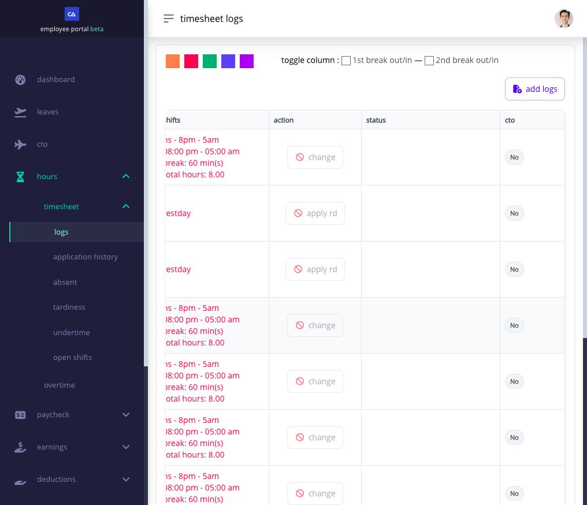

# apply for work on a rest day


**Rest-day work may need approval for premium pay.** Your timesheet records the hours you worked. Depending on your company's settings, an application and approval after the work may also be required before rest-day premium pay can be included. After your shift, check the timesheet row and the status of any rest-day request. A captured punch or submitted request alone does not confirm that the premium is approved.


if you work on a rest day, check your shift, capture your punches, and look for **Apply RD** in your timesheet. a rest day does not always mean you can start and finish at any time.

## what should i do before applying?

1. open **Shifts** and check the date and assigned schedule. if the shift is wrong, [request a shift change](../clock-in-and-shifts/request-a-shift-change.md).
2. use your available clock-in method. make the lunch or break punches required by that shift.
3. after working, open **Hours → Timesheet Logs**. find the date and check your punches.

## how do i use Apply RD?

when the timesheet row shows **Apply RD**:

1. select **Apply RD**. the form may be headed **Apply Rest Day** or **Working on the rest day**.
2. check the date, shift, and punches. if a punch is missing or wrong, enter the correct time in this form.
3. enter the reason for the rest-day work.
4. review the form and select **Submit** once.
5. check the status in your timesheet or **Timesheet Application**.

**Apply RD** requests approval for the rest-day work shown in that timesheet row. you can also enter a missing punch or correct a wrong time in the same form. the form requires a valid time in and time out before you submit. you do not need a separate **Change** request for that row.

## which action should i use if a punch is missing?

open **Hours → Timesheet Logs** and find the rest-day date:

* **a row is there and it shows Apply RD:** open that form. enter the missing punch or correct the wrong time, explain the rest-day work, and submit one request. a missing punch by itself does not remove the **Apply RD** label.
* **there is no row for that date:** select **Add Logs** to request the missing time entry. check its status in **Timesheet Application**. that request may already include the rest-day approval, so do not automatically file another request after it is approved.
* **the row shows Change:** use **Change** if a punch needs correcting. **Apply RD** may no longer appear because the rest-day work was already included or an earlier request was approved. check the earlier request's status before applying again.
* **the action is visible but disabled:** read the message beside it. for example, the shift may not have ended, another request may be pending, or the payroll period may prevent an application.

<figure><figcaption>
The Rest Day rows show where Apply RD appears in the Action column. These particular buttons are disabled, so they cannot be selected; check the message for your own row.
</figcaption></figure>

your company may also allow rest-day work without a separate request. if you still expect **Apply RD** and cannot use it, send HR the date, shift, punches, application status, and message shown. see [correct a missing or incorrect punch](correct-a-missing-or-incorrect-timesheet-punch.md) for the full timesheet steps.

## when will the work count?

a saved punch shows the time captured. an **Approved** request shows that the needed approval is complete. the work appears in pay only after your company's rest-day and payroll rules are applied. if the pay run is open, payroll may need to recalculate it. your company may instead convert approved work to [CTO](../leave-cto-and-maternity/apply-for-cto-when-it-is-available.md); the same work is not also paid as the same rest-day item.

if the date is also a holiday, use the action shown on that timesheet row. see [apply for holiday work](apply-for-holiday-work.md).

## related help

* [review your timesheet every day](review-your-timesheet-every-day.md)
* [correct a missing or incorrect punch](correct-a-missing-or-incorrect-timesheet-punch.md)
* [file and track overtime](file-and-review-overtime.md)
