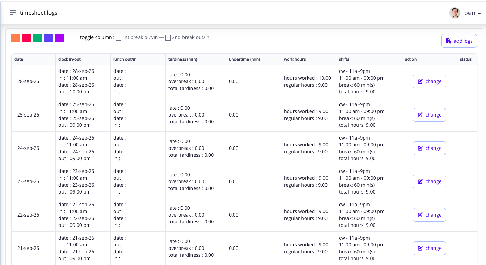
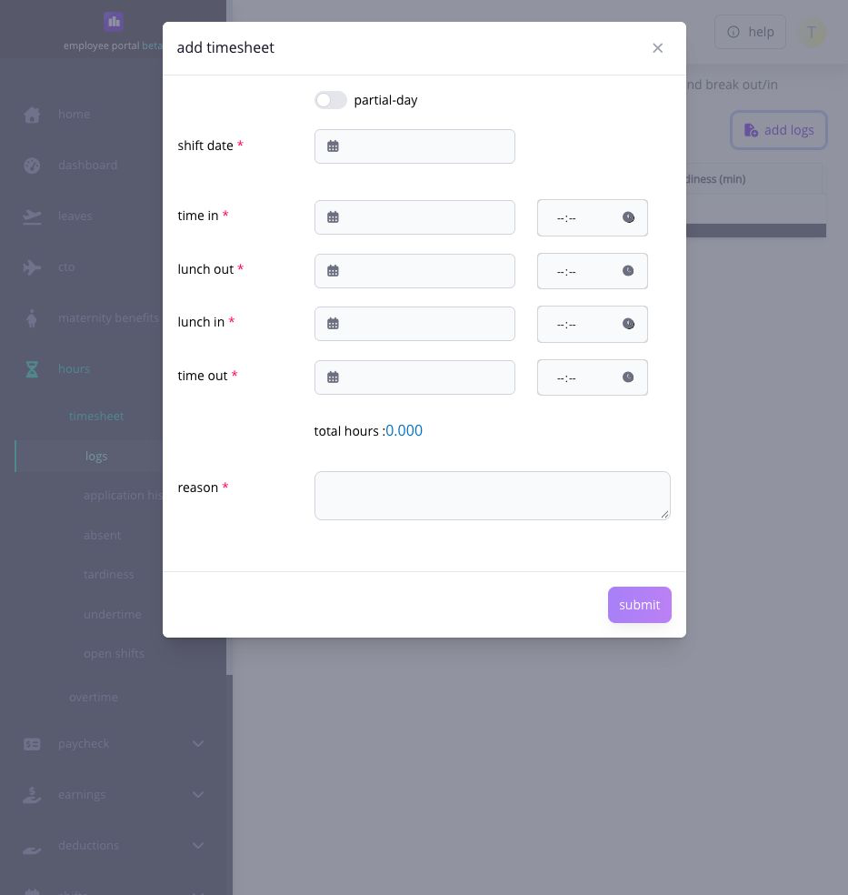
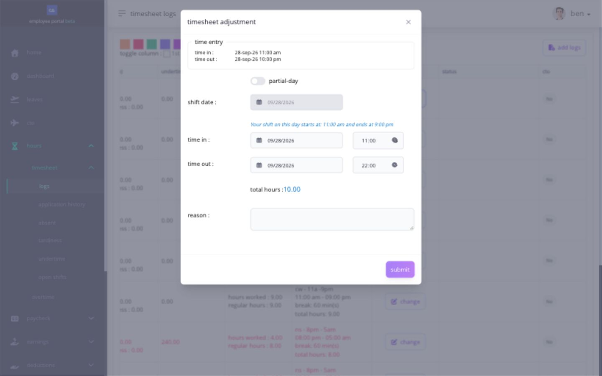

# correct a missing or incorrect timesheet punch

use **Hours → Timesheet Logs** after your shift to correct a missing or incorrect punch. if you worked on a rest day or holiday, follow the separate [rest-day](apply-for-rest-day-work.md) or [holiday](apply-for-holiday-work.md) guide.

the action depends on the date and what needs fixing. choose the action shown for that timesheet row.

| action shown   | use it for                                                                                        | what happens next                                                 |
| -------------- | ------------------------------------------------------------------------------------------------- | ----------------------------------------------------------------- |
| **Change**     | fix an existing time in, time out, lunch, or break entry                                          | your correction may need approval before it changes the timesheet |
| **Apply RD**   | request approval for rest-day work; enter a missing punch or correct a wrong one in the same form | follow the [rest-day work guide](apply-for-rest-day-work.md)      |
| **Apply Hol.** | request approval for holiday work; enter a missing punch or correct a wrong one in the same form  | follow the [holiday work guide](apply-for-holiday-work.md)        |
| **Add Logs**   | request a time entry when there is no timesheet row to change                                     | complete the Add Timesheet form and track the request status      |

<figure><figcaption>
In this example, the existing rows offer Change. A rest-day or holiday row may show a different action according to its current status and company settings.
</figcaption></figure>

if a date is both a rest day and a holiday, follow the action shown for that row. do not file two requests for the same work.

if the row shows **Apply RD** or **Apply Hol.**, complete any missing or wrong punch in that form and submit one request. a missing punch does not by itself change which action is labeled on an existing row. if there is no row at all, use **Add Logs**. after an earlier request is approved, the row may show **Change** because rest-day or holiday work is already included; check the request status before filing the same work again.


**a saved punch is not the same as approved or paid work.** a saved punch confirms that Ashima captured your time. if your company requires an application, wait for approval. payroll then applies the rules for your work and pay period.


## first check the shift and timesheet row

before changing anything, compare the row with the shift assigned for that date. the shift tells Ashima:

* when work is expected;
* which punches are required;
* whether lunch or additional break punches are tracked;
* the scheduled hours;
* whether the date is a workday or rest day; and
* how the captured logs should be interpreted for attendance.

if the shift is wrong, use a [shift-change request](../clock-in-and-shifts/request-a-shift-change.md). changing the punches to fit an incorrect shift can leave the schedule, attendance result, and payroll result inconsistent.

if the shift is correct but a punch is missing or wrong, use the action on the timesheet row.

## how do i know that a punch was captured?

after using the desktop clock, kiosk, or mobile clock:

1. wait for the success result;
2. confirm the action and captured time shown on the clock screen; and
3. open or refresh **Hours → Timesheet Logs** and find the correct work date.

the row can show the shift date, clock in and clock out, lunch out and lunch in, tracked additional breaks, tardiness, undertime, hours worked, regular hours, assigned shift, action, and application status.

do not click the clock repeatedly while waiting for the timesheet. your company sets a minimum interval between captured punches. when the company has not supplied a positive interval, the shared default is five minutes. if you try again too soon, Ashima displays the minimum interval that still applies.

the minimum interval controls when another punch can be accepted. it is not a waiting period that makes the first punch valid. once the success result appears, check **Timesheet Logs**. if the punch is still missing after refreshing the page, keep the success message or screenshot and contact HR or your administrator instead of creating repeated punches.

## how do i add logs when there is no row to change?

use **Add Logs** when you need to request a missing time entry and there is no existing row to correct. if a row already exists for the shift date, use its displayed action instead.

1. open **Hours → Timesheet Logs** and select **Add Logs**.
2. enter the **shift date** and the time in and time out that actually occurred.
3. complete the lunch fields shown as required for your request. use **partial-day** only if it matches the work you performed.
4. enter a reason that explains the missing entry.
5. review the date, punch order, calculated **total hours**, and any validation message before selecting **Submit** once.
6. check **Timesheet Application** for the request's status. a submitted request is not automatically an approved or paid timesheet entry.

<figure><figcaption>
Use Add Logs when there is no row to change. Check the shift date and required punches before submitting; this example form was not submitted.
</figcaption></figure>

## how do i correct a normal workday timesheet?

use **Change** when the assigned shift is correct, a punch is missing or wrong, and **Change** is the action shown for that row. if the row instead shows **Apply RD**, use its form to correct wrong punches and request rest-day approval together.

1. go to **Hours → Timesheet Logs**.
2. find the correct shift date. for an overnight shift, use the work date under which Ashima placed the shift instead of assuming the calendar date of the final clock out.
3. compare the displayed punches with the assigned shift and the work that actually occurred.
4. select **Change**.
5. review the original **Time Entry** values and the schedule explanation shown in the form.
6. enter the correct **time in** and **time out**.
7. enter lunch and additional break punches only when those fields are enabled for your shift. do not add break punches merely because a field is blank.
8. use **partial-day** only when the correction covers the supported part of the day.
9. enter a clear reason that explains what was wrong and what you corrected.
10. review the calculated actual hours and any validation message, then submit once.
11. return to **Timesheet Logs** or the applicable application list and monitor the status.

<figure><figcaption>
Compare the original entry with the proposed punches and assigned shift before submitting. This example was not submitted.
</figcaption></figure>

the form requires a valid time in, time out, time order, and positive calculated duration. Ashima can also validate the lunch and additional-break sequence when those punches apply.

after you submit, check the request status. when approval is required, the corrected entry should appear in your timesheet after approval. a closed payslip does not change automatically.

## what are excess hours?

**Excess Hours** identifies a captured time log that Ashima could not match to the assigned shift's recognized punch sequence or work period. Ashima keeps the entry visible so you and your administrator can trace what was captured, but the excess entry is not treated as an actual log for the shift. it is excluded from **Actual Hours**, **Regular Hours**, and payable hours.


**never edit an Excess Hours row to make it payable.** changing the excess entry does not turn it into recognized work and the edited excess time will still not be paid. correct the assigned shift, the normal timesheet row, or the required work application that caused the mismatch.


an excess-hours row can appear when:

* more punches were captured than the shift normally expects;
* a punch was captured more than once;
* a punch falls outside the period Ashima can match to the expected shift;
* a required punch is missing, leaving another entry unmatched; or
* the assigned shift does not match the schedule that was actually worked.

for a uniform shift, Ashima begins matching the next shift up to two hours before its scheduled start. a much earlier punch can be associated with surrounding work or shown separately as excess hours, depending on the other logs. the two-hour matching rule is not a universal rule for flexible, open, overnight, rest-day, or holiday shifts.

to reduce avoidable excess logs:

* check the assigned shift before the workday;
* use only the punches required by that shift;
* wait for the success result before attempting another punch;
* respect the displayed minimum interval between punches;
* do not create a second time in because the first punch has not yet appeared on a refreshed page; and
* request a shift correction promptly when the displayed schedule is wrong.

if the time shown as excess represents work you were authorized to perform, leave the **Excess Hours** row unchanged and contact HR or your administrator. review the date, assigned shift, normal timesheet row, and the required overtime, rest-day, holiday, open-shift, or shift-change application. once the correct source record is accepted, the administrator can resolve or recalculate the timesheet using the recognized record.

an excess log is therefore different from overtime. **Overtime** is eligible work interpreted through the applicable overtime rules and approvals. **Excess Hours** is an unmatched captured entry and does not count toward pay.

## why is the action unavailable?

Ashima can disable **Change**, **Apply RD**, **Apply Hol.**, or **Add Logs** when:

* the assigned shift has not ended;
* the selected shift date is in the future;
* another application already covers the record;
* the payroll period is frozen or applications are suspended;
* the payroll is closed and the correction is not eligible for the available post-payroll process;
* the company's post-payroll adjustment settings or date limits do not allow the request; or
* the row's existing status prevents another application.

read the tooltip or message beside the disabled action. send HR or your administrator the employee name, shift date, assigned shift, affected punch, action you expected, current application status, payroll period, and exact message.

## what happens after i submit?

the request enters the Workflow configured by your company. while it is pending, do not submit another request for the same record unless the first request was rejected or cancelled and Ashima allows a replacement.

after approval:

* the accepted values become available to the timesheet;
* Ashima interprets them again using the assigned shift and applicable rules;
* rest-day or holiday work becomes eligible for its next payroll or CTO step when the other requirements are satisfied; and
* an open payroll may still need recalculation before the corrected result appears in pay.

if payroll is already closed, HR or payroll may need to use a supported post-payroll adjustment. the approved timesheet request alone does not change a completed payslip.

## related articles

* [review your timesheet every day](review-your-timesheet-every-day.md)
* [understand the ways you can clock in](../clock-in-and-shifts/understand-the-ways-you-can-clock-in.md)
* [check your shift before every workday](../clock-in-and-shifts/check-your-shift-before-every-workday.md)
* [request a shift change](../clock-in-and-shifts/request-a-shift-change.md)
* [understand attendance exceptions](understand-attendance-exceptions.md)
* [correct an eligible record through PPA](correct-open-shift-hours-and-request-a-ppa.md)
* [apply for work on a rest day](apply-for-rest-day-work.md)
* [apply for work on a holiday](apply-for-holiday-work.md)
