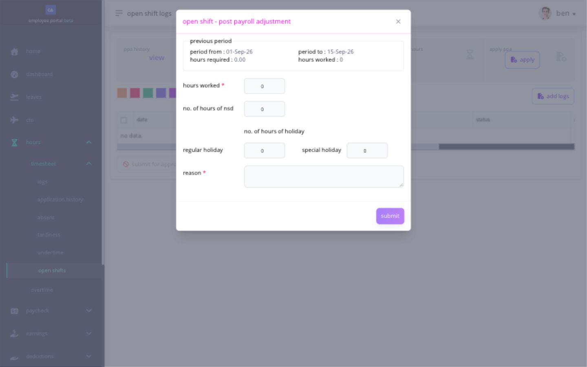

# correct an eligible record through PPA

**Post Payroll Adjustment (PPA)** lets you request a correction to certain time or leave records after the original payroll has closed. use it only when Ashima shows **PPA** for that record. for a current open payroll, use the normal correction action instead.

PPA does not reopen the old payroll or change its payslip. after approval, payroll reviews the correction in an open pay run and calculates any difference in pay.

## when is an employee PPA available?

all of these conditions matter:

* the source record belongs to a closed payroll;
* your company enabled PPA;
* your company enabled employee-initiated PPA;
* the affected date is within the configured limit of previous payroll dates;
* the correction type is supported;
* the date is within the current supported year boundary;
* no earlier PPA has already been used for the same employee and date; and
* the source record and request status allow another action.

your company's limit can cover one to six previous payroll dates. this is a payroll-period limit, not simply a number of calendar months, and it does not guarantee that every date in the range is eligible.

## what can PPA correct?

Ashima can use PPA for supported late time and attendance corrections, including eligible:

* timesheet adjustments or missed punches;
* open-shift hours;
* missed rest-day or holiday work requests;
* leave corrections; and
* missed overtime.

start from the affected timesheet, open-shift, leave, or overtime record. PPA is not a general form for changing any past payroll item.

## how do i request an open-shift PPA?

an **open shift** is recorded work that follows the supported open-shift path instead of matching a normal assigned shift.

| page                   | use it for                                                                           |
| ---------------------- | ------------------------------------------------------------------------------------ |
| **Open Shift History** | review the work date, hours, status, payroll state, and reason an action is disabled |
| **Open Shift PPA**     | request an eligible post-payroll correction for open-shift hours                     |

1. open the affected record in **Open Shift History** or **Open Shift PPA**.
2. confirm the closed payroll period, pay date, work date, and currently recognized hours.
3. select **Apply** when the PPA action is enabled.
4. enter a positive number of correct hours and a clear reason.
5. review the old and requested information.
6. submit once.
7. confirm that the PPA appears in history with its current status.

<figure><figcaption>
The open-shift PPA form identifies the previous pay period and separates total worked hours from night differential and holiday hours. This example was not submitted.
</figcaption></figure>

**Hours Worked** is the corrected total for the eligible open-shift work. enter **No. of Hours of NSD** only for the night-shift-differential portion, and enter **Regular Holiday** or **Special Holiday** hours only when that date and work qualify for those categories. these fields describe portions of the work, not additional hours to add on top of the total. use **Reason** to explain why the earlier record needs correction. compare the request with your actual timesheet before submitting; payroll and approval rules decide the resulting adjustment.

## what happens after i submit?

your request may need approval. submitting it does not change a payslip. after approval, payroll reviews the adjustment in an open pay run before the corrected amount can appear in pay.

check the request history for **Pending**, **Approved**, **Rejected**, or another displayed status. if it is approved but the amount is not yet visible in pay, ask payroll which open pay run will take up the PPA.

## why is Apply unavailable?

common reasons include:

* the related payroll is still open or only waiting for approval;
* PPA or employee-initiated PPA is disabled;
* the date is older than the configured payroll limit;
* the correction is outside the supported year boundary;
* an earlier PPA already used the employee/date;
* another application is pending; or
* the source record is not one of the supported PPA types.

read the message shown by Ashima. send HR or payroll the source page, affected date, closed pay period, action expected, current request status, and exact message. do not create an unrelated adjustment to bypass the PPA boundary.

## related articles

* [correct a missing or incorrect timesheet punch](correct-a-missing-or-incorrect-timesheet-punch.md)
* [apply for work on a rest day](apply-for-rest-day-work.md)
* [apply for work on a holiday](apply-for-holiday-work.md)
* [apply for leave and track the request](../leave-cto-and-maternity/apply-for-leave.md)
* [file and track an overtime request](file-and-review-overtime.md)
* [understand your payslip](../pay/understand-your-payslip.md)
