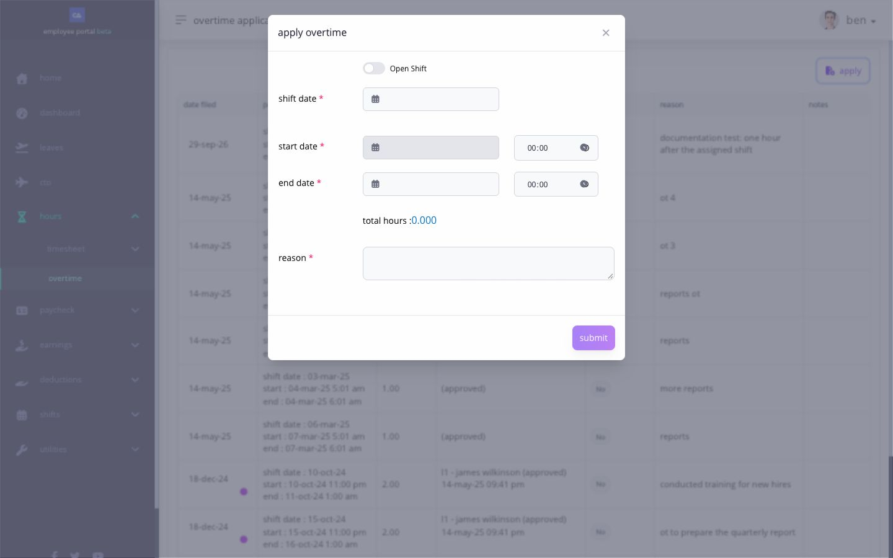

# file and track an overtime request


**Working overtime after your shift? Stay clocked in until the work ends.** Do not clock out when your scheduled shift ends and then clock in again for overtime. Clock out when you finish the overtime. Ashima checks your overtime request against the time in and time out in your timesheet. For example, if your shift ends at 5:00 p.m. and you work until 7:00 p.m., clock out at 7:00 p.m.; do not make a 5:00 p.m. time out followed by another time in. Make any lunch or break punches required by your shift.

**Overtime pay needs approval.** After the work, check that your overtime request matches the hours recorded in your timesheet and reaches **Approved** status. Permission to work overtime in advance, an overtime request, or a late clock-out alone does not make those hours payable. Ashima uses the approved request and actual worked hours, then applies your company's overtime rules.


use **Hours → Overtime** to file and track eligible work beyond your assigned shift. overtime is different from simply staying clocked in longer: the assigned shift, actual punches, employee entitlement, company thresholds, and approval all affect the result.

## before you apply

confirm:

* the correct work date and assigned shift;
* the actual or intended overtime period;
* whether your company allows pre-shift, post-shift, rest-day, holiday, or open-shift overtime for the record;
* that the requested time does not overlap leave, another overtime request, or another timesheet period; and
* that the required timesheet punches exist when the request is for work already completed.

an overtime request does not create missing timesheet punches. correct the timesheet first when the captured time is wrong. if you already clocked out at shift end and clocked in again for overtime, review the recorded punches in **Timesheet Logs** and ask HR which correction is needed before relying on that record for overtime.

## how do i file overtime?

1. open **Hours → Overtime**.
2. select **Apply**.
3. choose the overtime path offered by the page.
4. select the date and review the shift returned by the eligibility check.
5. enter the supported start, end, duration, and reason.
6. compare the requested period with the actual timesheet.
7. submit once.
8. return to the overtime list and confirm the request and status.

<figure><figcaption>
The overtime form calculates total hours from the requested period. The example is unsubmitted; check the timesheet and shift before filing.
</figcaption></figure>

## how much overtime will count?

requested time and payable overtime can differ. Ashima applies the company overtime rules to eligible approved work. those rules can include:

* a grace period before overtime begins;
* a minimum eligible duration;
* a maximum or cap;
* whether pre-shift overtime is allowed;
* the assigned shift and actual punches;
* the date classification, such as workday, rest day, or holiday; and
* employee overtime entitlement.

for example, a request covering 90 minutes does not guarantee 90 payable minutes if the company applies a grace period, minimum, cap, or if the actual punches support a shorter period.

## how do i know whether it was approved?

open the overtime list and find the request by date. review its current status and the approver detail shown.

* **Pending** means the request is still waiting for a decision.
* **Approved** means the approval requirement completed; payroll still applies the applicable overtime and pay rules.
* **Rejected** means the request stopped and does not become eligible overtime.
* **Cancelled** means the request was withdrawn through the supported action.

approval does not repair a missing punch and does not rewrite a closed payslip.

## why is Apply unavailable?

Ashima can block a request when overtime entitlement is unavailable, the assigned shift or timesheet is incomplete, the time overlaps another record, the requested duration violates a threshold or cap, another application already exists, payroll is frozen, or the payroll has closed.

if the related payroll is closed, use the PPA action only when Ashima presents it and the record meets the company PPA rules. see [correct an eligible record through PPA](correct-open-shift-hours-and-request-a-ppa.md).

## related articles

* [review your timesheet every day](review-your-timesheet-every-day.md)
* [correct a missing or incorrect timesheet punch](correct-a-missing-or-incorrect-timesheet-punch.md)
* [apply for work on a rest day](apply-for-rest-day-work.md)
* [apply for work on a holiday](apply-for-holiday-work.md)
* [understand and apply for CTO](../leave-cto-and-maternity/apply-for-cto-when-it-is-available.md)
