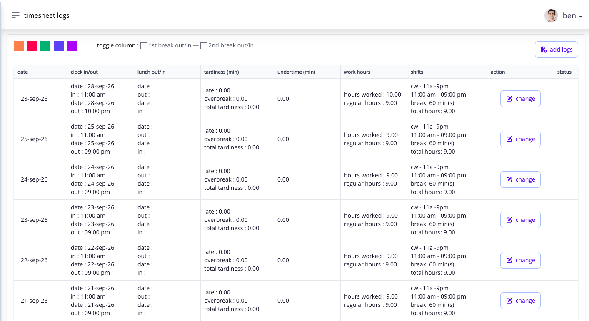

# review your timesheet every day

open **Hours → Timesheet Logs** after your shift and compare the saved record with what happened that day.

check:

* the assigned shift and date;
* time in and time out;
* required lunch and break punches;
* the source and status of the record; and
* absence, tardiness, undertime, overtime, or open-shift indicators.

<figure><figcaption>
Compare each day's punches with its assigned shift and calculated hours. This example uses a fictitious test employee.
</figcaption></figure>

the **source** identifies how the timesheet punch was added: desktop clock, kiosk, mobile clock, an API timekeeping integration, an approved timesheet application, or an administrator-entered or uploaded record. the **status** tells you whether the displayed item is final, pending review, or otherwise still being processed where that state is shown.

the dashboard may summarize an exception, but **Timesheet Logs** holds the detailed record you need to investigate. if something is wrong, file the supported adjustment after the assigned shift has ended. Ashima may prevent an adjustment while the shift is still in progress because the day's record is not yet complete.

do not wait for cutoff. payroll locks, existing applications, approval timing, or completed payroll can later limit the available correction path.

## what should i check on each row?

review the work date, assigned shift, required punches, actual hours, regular hours, tardiness, overbreak, undertime, absence, application status, and any excess entry. the timesheet records the punches; the shift tells Ashima how to interpret them.

if **Excess Hours** appears, treat it as an unmatched captured entry rather than actual payable work. do not edit the excess row. correct the assigned shift, normal timesheet, or required application that caused the mismatch.

if you worked on a rest day or holiday, check whether the row offers **Apply RD** or **Apply Hol.**. the rest-day form can include a correction to wrong punches on the same row. after its request is approved, **Apply RD** may no longer appear. **Change** is the punch-correction action when that is what the row shows. see [apply for rest-day work](apply-for-rest-day-work.md) or [apply for holiday work](apply-for-holiday-work.md).

## when should i correct a problem?

wait until the assigned shift ends, then submit the supported correction as soon as possible. do not wait for cutoff or for payroll to discover it. once payroll closes, the ordinary correction can be unavailable and the record must meet PPA rules before an employee request can proceed.
