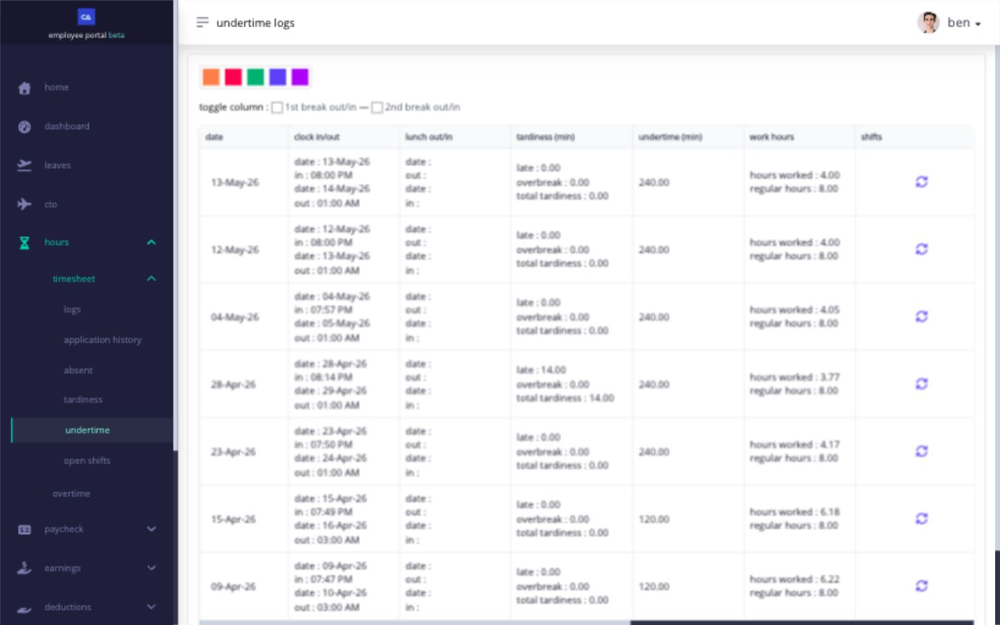

# understand attendance exceptions

use **Absent**, **Tardiness**, **Overbreak**, and **Undertime** to investigate an exception before deciding what to request.

| exception     | what it generally means                                                                           | what to check first                                                                         |
| ------------- | ------------------------------------------------------------------------------------------------- | ------------------------------------------------------------------------------------------- |
| **Absent**    | a scheduled workday has no qualifying timesheet punches or approved leave covering it             | assigned shift, approved leave, holiday or rest-day classification, and timesheet punches   |
| **Tardiness** | the applicable time in is later than the assigned shift allows                                    | shift start, captured time in, and pending shift or timesheet applications                  |
| **Overbreak** | a tracked lunch or additional break lasted longer than the duration allowed by the assigned shift | required break punches, allowed break duration, and pending shift or timesheet applications |
| **Undertime** | the worked time or time out does not satisfy the assigned shift                                   | shift end, captured time out, required breaks, and pending applications                     |

use the item that is wrong to choose the request. file a shift application when the schedule is wrong, a timesheet application when a punch is wrong, and a leave request when the timesheet is correct but approved leave should cover the absence.

<figure><figcaption>
The example shows undertime rows, including one with tardiness. Compare the punches and shift on the same date to understand the exception.
</figcaption></figure>

## why do i have overbreak?

Ashima uses your assigned shift to determine whether lunch or another break must be tracked and how long that break may last. when the time between the applicable break-out and break-in punches is longer than the allowed duration, the additional minutes can appear as **Overbreak**. those minutes can also form part of the day's **Total Tardiness**.

for example, if your shift allows a 60-minute tracked lunch and your lunch punches show a 75-minute break, Ashima can identify the additional 15 minutes as overbreak. the result can differ when your shift has different break rules or when the company applies rounding or grace settings.

overbreak can also appear when:

* a break-in or break-out punch is missing or incorrect;
* the wrong shift is assigned for the date; or
* the shift's break duration does not match the schedule you were instructed to follow.

check the assigned shift and all break punches before submitting a request. if the shift is correct but a punch is wrong, use **Change** after the shift ends and enter the time that actually occurred. if the shift is wrong, request a shift change instead of changing your punches to fit it. your company may require approval before the corrected result appears.

do not add lunch or break punches merely because a field is blank. those punches are required only when the assigned shift tracks that break.

## what is the difference between overbreak and undertime?

**Overbreak** measures tracked break time beyond the duration allowed by the shift. **Undertime** generally measures scheduled work not completed by the expected end of the shift. both depend on the assigned shift and the accepted punches, but they describe different attendance exceptions.

## related articles

* [correct a missing or incorrect timesheet punch](correct-a-missing-or-incorrect-timesheet-punch.md)
* [check your shift before every workday](../clock-in-and-shifts/check-your-shift-before-every-workday.md)
* [request a shift change](../clock-in-and-shifts/request-a-shift-change.md)
