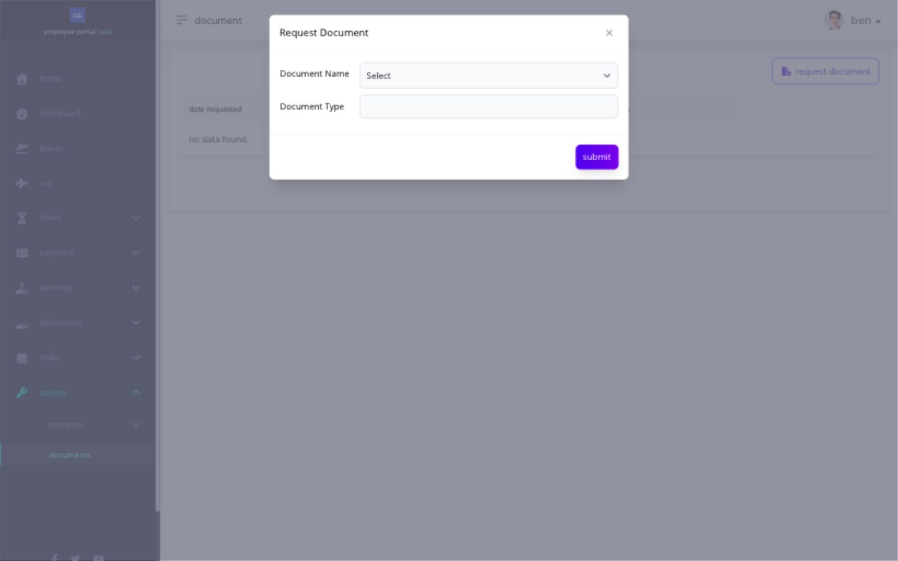

# request a document

the Employee portal lets you request an available document and review the status of your request under **Utilities → Documents**.

for contribution and tax tables, see [use statutory reference tables](pay/use-statutory-reference-tables.md) in the pay section.

## how do i request a document?

1. go to **Utilities → Documents** and select **Request Document**.
2. choose a **Document Name** offered to your account. the test account currently offers **COE** (certificate of employment); available names can differ by company.
3. review **Document Type** if the form fills or requests it.
4. select **Submit** once, then return to the list and check its date, document name, type, and status.

<figure><figcaption>
Choose the offered document and review its type before submitting. the test account had no prior requests; this form was not submitted.
</figcaption></figure>

if the needed document is not offered or a submitted request does not appear in the list, give HR the document name, the date you tried to request it, and the message or status shown. if a completed document is made available to open or download, verify its name and period before using it.
