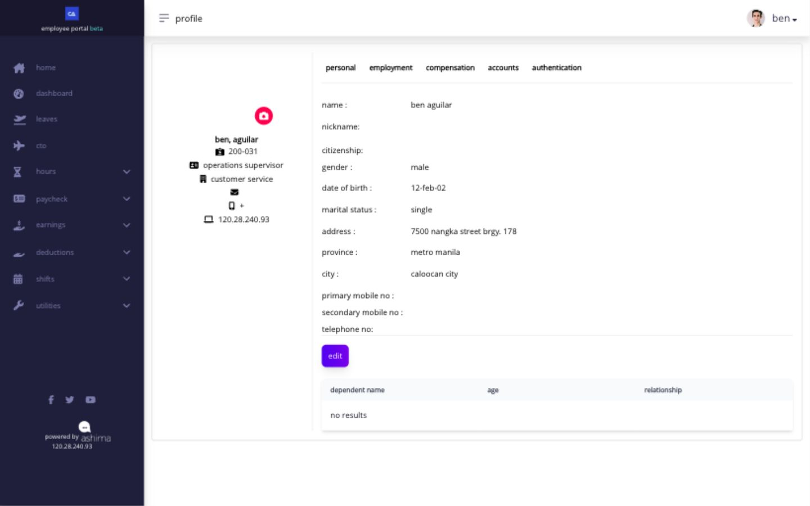
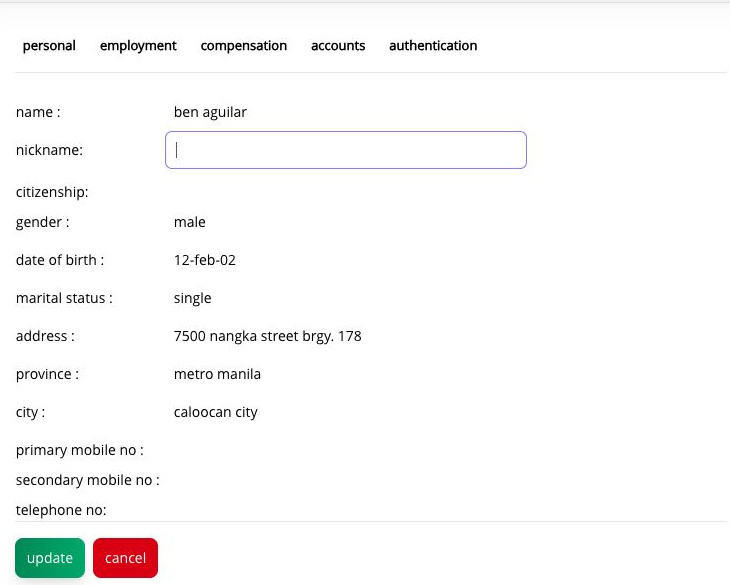

# view and update your profile

Open **Profile** from the menu beside your name. Your profile has five tabs: **Personal**, **Employment**, **Compensation**, **Accounts**, and **Authentication**.

<figure><figcaption>
Choose a tab to review its details. An Edit button appears only where you can make a change yourself.
</figcaption></figure>

| tab                | what you can check                                                                     |
| ------------------ | -------------------------------------------------------------------------------------- |
| **Personal**       | Your name, nickname, birth date, address, and contact details.                         |
| **Employment**     | Your employee ID, position, department, reporting line, and government ID information. |
| **Compensation**   | Your basic pay, hourly rate, bank account shown here, and salary-change history.       |
| **Accounts**       | The controls for changing your account password.                                       |
| **Authentication** | Whether two-factor authentication is set up, and the setup control.                    |

## what can i change myself?

On the **Personal** tab, select **Edit** to change your **nickname**, then select **Update**. Check that the new nickname appears when the page returns to its normal view. The profile picture has a separate upload control if you want to change it. On **Accounts**, use **Edit** when you need to change your password. Use **Authentication** to [set up two-factor authentication](account-and-orientation/set-up-and-use-two-factor-authentication.md) if your company requires it.

<figure><figcaption>
Only the nickname becomes an entry field in this Personal Edit view. Check it before selecting Update.
</figcaption></figure>

Your name and the other personal, employment, and compensation details shown on these tabs are not editable through the Personal **Edit** form. For example, if your name needs correcting, ask HR or your administrator to update it. Tell them which detail is wrong and what it should say; include the effective date if it matters for employment or payroll records.


Changing your nickname or profile picture does not change your legal name or payroll records. If a displayed bank, government ID, pay, or employment detail is wrong, ask HR or your administrator to check the record that owns it.

