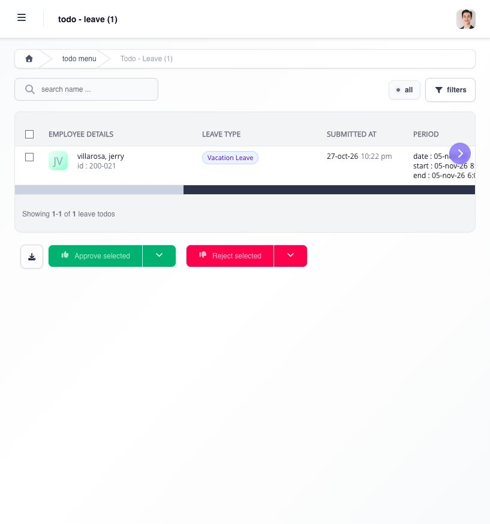
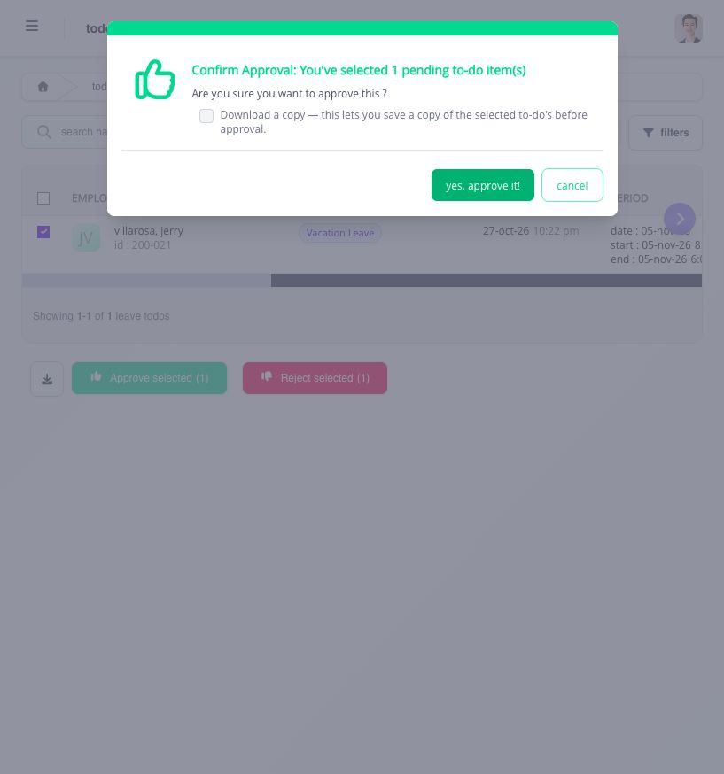

# approve or reject a request

use **To Do** to decide requests assigned to you. check the employee, dates, requested change, and supporting records before making a decision.

## how do i review and decide a leave request?

1. open **To Do**, then choose **leave**.
2. find the employee's request. review the leave type, submission date, leave period, requested days, previous balance, reason, and approval status. use the table arrows to see columns that do not fit on screen, including any attachment.
3. compare the request with the employee's schedule and leave balance where needed.
4. select the checkbox for the request. check the selected-item count before choosing **Approve selected** or **Reject selected**. select several rows only when you intend to decide them together.
5. read the confirmation and complete any required information. the approval confirmation may offer **Download a copy**. choose **cancel** if the selection or decision is wrong; otherwise, confirm once.
6. return to the list and check the updated status or that the request has left your pending queue.

<figure><figcaption>
review the request across the table's columns before selecting it for a decision.
</figcaption></figure>

<figure><figcaption>
check the selected-request count before confirming. choosing cancel leaves the request undecided.
</figcaption></figure>

## what should i check for other request types?

open the relevant **To Do** category and review the information shown for that request. confirm the company, employee, dates, current status, and requested change. compare the relevant shift, timesheet, or supporting record, and review attachments, remarks, and earlier approval history where shown. follow that category's decision controls and verify the saved result.

## what does approval change?

your approval records your decision. the request may still need further approval before it is final. check its status rather than assuming your action completed the whole workflow. final approval makes the accepted result available to the related process, which can still require recalculation or payroll review.

rejection stops the request. it does not repair an incorrect shift, punch, balance, or payroll result. when a remark is available, explain what needs correction so the employee or an authorized user can submit a corrected request when needed.

## why is the action unavailable?

refresh the request and check whether another approver already acted, the request moved to another level, the source record changed, applications are suspended, or payroll is frozen or closed. if your action appears not to have saved, check for a message and the current status before trying again. ask the workflow administrator to review the exact request and level when the expected action remains unavailable.

see [understand locked, closed, and reassigned approval work](understand-locked-closed-and-reassigned-approval-work.md) for the next step when a request is blocked.
