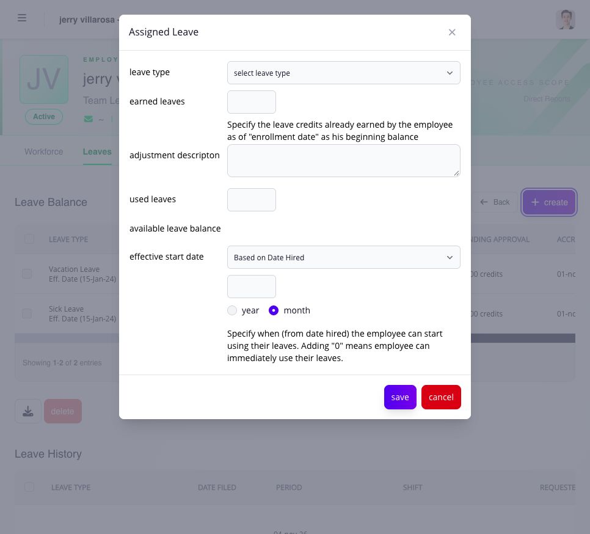
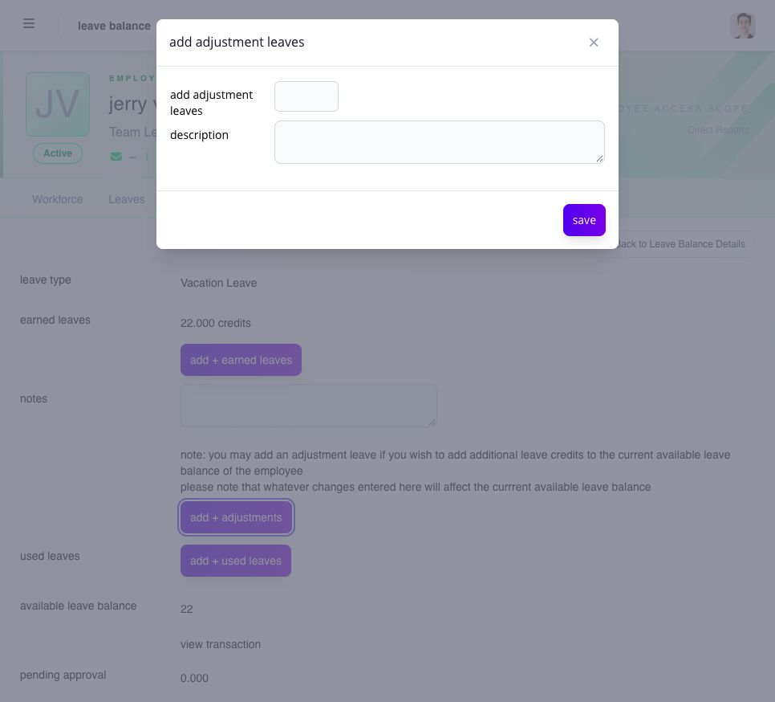
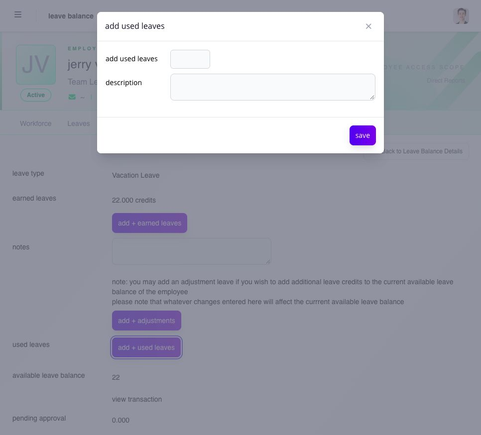

# correct, adjust, cancel, or delete leave records

leave actions have different accounting and audit effects. choose the action that matches the business event instead of using a balance adjustment as a general workaround.

| action           | use it for                                                                                             | result to verify                                                       |
| ---------------- | ------------------------------------------------------------------------------------------------------ | ---------------------------------------------------------------------- |
| add earned leave | record an authorized earned amount that did not arrive through the expected earning process            | earned and available balances increase with a ledger row               |
| add adjustment   | correct the balance with an authorized positive or negative amount                                     | adjustment reason and resulting balance appear in the ledger           |
| add used leave   | record an authorized use that belongs in the ledger but was not created through the normal application | used and available balances reflect the entry                          |
| update details   | correct fields the current record allows you to maintain                                               | saved detail remains visible after reload                              |
| cancel leave     | withdraw an eligible pending or approved application                                                   | status changes and eligible credits return through the ledger          |
| delete or purge  | remove only a record the page and company policy allow to be removed                                   | the supported record disappears without leaving an unexplained balance |

## assign a leave type

use **create** in the employee's **Leave Balance** to open **Assigned Leave**. this establishes the employee's leave assignment; it does not request dates off.

1. choose the company-defined **leave type**. check for an existing assignment first.
2. enter the authorized **earned leaves** opening amount and **used leaves**, and explain the opening adjustment in the description.
3. review **available leave balance**.
4. set **effective start date** using **Based on Date Hired** or **Custom Date**, as appropriate. for the hire-date option, enter the number of months or years after hire when the employee can begin using the leave; zero means immediate use.
5. select **save**, then check the assigned type, effectivity and balance on the employee record.

<figure><figcaption>
assign the correct leave type and opening balances, then set when the employee may begin using it.
</figcaption></figure>

## add earned, adjustment, or used leave

open the employee's **Leaves** record and select the leave type name. its detail page has separate **add + earned leaves**, **add + adjustments**, and **add + used leaves** buttons. each opens its own amount-and-description form.

1. inspect the existing balance and transactions first.
2. choose the button that matches the event in the table above.
3. enter the authorized amount and a description explaining why it is being entered.
4. review the amount and select **save** once.
5. reopen **view transaction** and confirm the resulting movement and balance. do not repeat the entry merely because another view has not refreshed yet.

<figure><figcaption>
use earned leave for an authorized credit that needs to be recorded, with a description of its source.
</figcaption></figure>

<figure><figcaption>
use an adjustment for a documented balance correction; check the ledger first to avoid duplicating an earlier entry.
</figcaption></figure>

<figure><figcaption>
record used leave only when the use is not already represented by an application or another ledger entry.
</figcaption></figure>

## before changing a record

confirm the employee, leave type, unit, amount, effective date, source request, approval status, reason, and payroll state. review the transaction ledger first so the correction does not duplicate an earlier earning, use, return, or adjustment.

do not use a leave adjustment to correct an assigned shift, missing punch, overtime request, or closed payroll result.

## when can leave be cancelled?

the cancellation action can be blocked when:

* the request was marked non-cancellable;
* it was already rejected or cancelled;
* approved leave has already passed;
* the related payroll is closed;
* applications are suspended by the current payroll lock;
* another process already changed the record; or
* an eligible balance is not available to receive returned credit.

pending and approved leave can follow different cancellation paths. read the status and control shown for the record. if the related payroll is closed, use the supported PPA path only when Ashima presents it and the company rules allow it.

## what happens to the balance after cancellation?

eligible reserved or approved credits return according to the leave type's rules. the transaction ledger should show the reversal and resulting balance. expired credits do not become reusable simply because the related request was cancelled.

for CTO, returned credits must go back to an eligible pool for the same CTO type. if an application used more than one expiry pool, the configured return order preserves the traceable credit history. do not manually recreate CTO unless an authorized correction is actually required.

## verify the change

after saving:

1. reopen the application or balance detail;
2. confirm the resulting status;
3. open **View Transaction** and verify the movement, reason, and balance;
4. review the employee's timesheet for the affected date; and
5. ask payroll to recalculate an affected open pay run when required.

## related articles

* [review an employee's leave, CTO, and balance history](review-leave-history-and-balances.md)
* [file leave for an employee](file-leave-for-an-employee.md)
* [understand locked, closed, and reassigned approval work](../approvals/understand-locked-closed-and-reassigned-approval-work.md)
