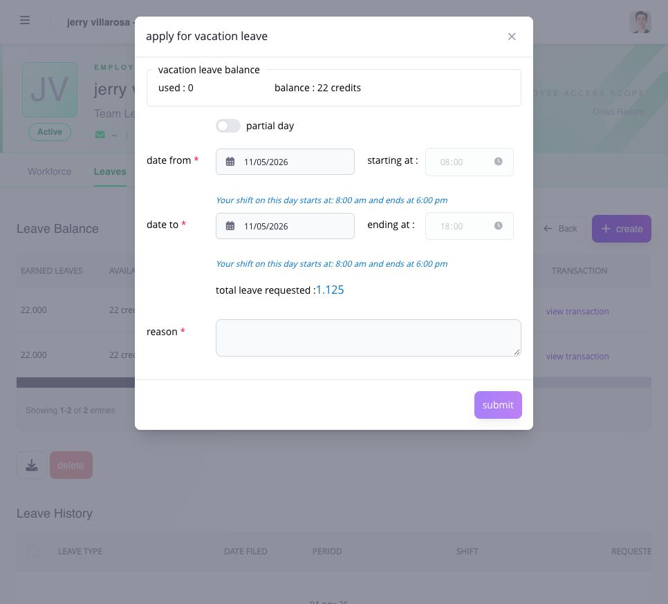

# file leave for an employee

employees should normally file their own request. file on an employee's behalf when the employee cannot submit it, the business reason supports manager filing, and your Manager portal access includes the action.

## before you file

confirm:

* the employee is within your assigned scope;
* the correct leave or CTO type is assigned;
* the requested dates and duration;
* the assigned shift for every covered date;
* the available and pending balance;
* any overlapping leave, timesheet, rest-day, holiday, or overtime record;
* the required supporting documents; and
* whether the applicable payroll is open, locked, or closed.

do not select another leave type to bypass a missing assignment, disabled **Apply**, or insufficient balance.


**filing also approves the leave:** when your Manager access allows you to file for the employee, a successful submission is recorded as **Approved**. it does not wait for another approver in To Do. review the dates and leave amount before submitting, then check **Leave History** for the saved result. use **To Do** separately for employee-submitted requests assigned to you.


## submit the request

1. open the employee's record and select **Leaves**. confirm the employee name and ID at the top.
2. find the assigned leave type in **Leave Balance** and select its **apply** button. **create** assigns a leave type; it does not file a request.
3. check the displayed used and available balance, then choose **date from** and **date to**.
4. review the shift times that appear for the dates. for part of a day, enable **partial day** and enter the supported start and end times.
5. check **total leave requested**. use this calculated amount rather than assuming every calendar day consumes exactly one credit; the shift and leave rules affect the result.
6. enter the reason. provide supporting documents when required by the leave type and the application flow.
7. review the employee, dates, hours and amount, then select **submit** once.
8. open the employee's **Leave History** and verify the request and its actual status.

<figure><figcaption>
the form shows the assigned shift times and calculated leave amount before submission. check these values before filing for the employee.
</figcaption></figure>

## why is the action unavailable?

the action can be unavailable because the employee is outside your scope, the manager permission is off, the leave type is not assigned or not yet effective, the balance rule blocks the request, another record overlaps the dates, applications are suspended, or the related payroll has closed.

use the message shown by Ashima. ask the administrator to review manager access, leave assignment, company policy, or PPA availability when the condition is outside your manager role.

## what should i verify after filing?

confirm the employee, leave type, dates, requested amount, filing source, status, and approver path. after approval, verify the employee's timesheet and transaction ledger. a submitted or approved request does not automatically rewrite a closed payroll.

## related articles

* [review an employee's leave, CTO, and balance history](review-leave-history-and-balances.md)
* [review requests in To Do](../approvals/review-requests-in-to-do.md)
* [correct, adjust, cancel, or delete leave records](correct-adjust-cancel-or-delete-leave-records.md)
