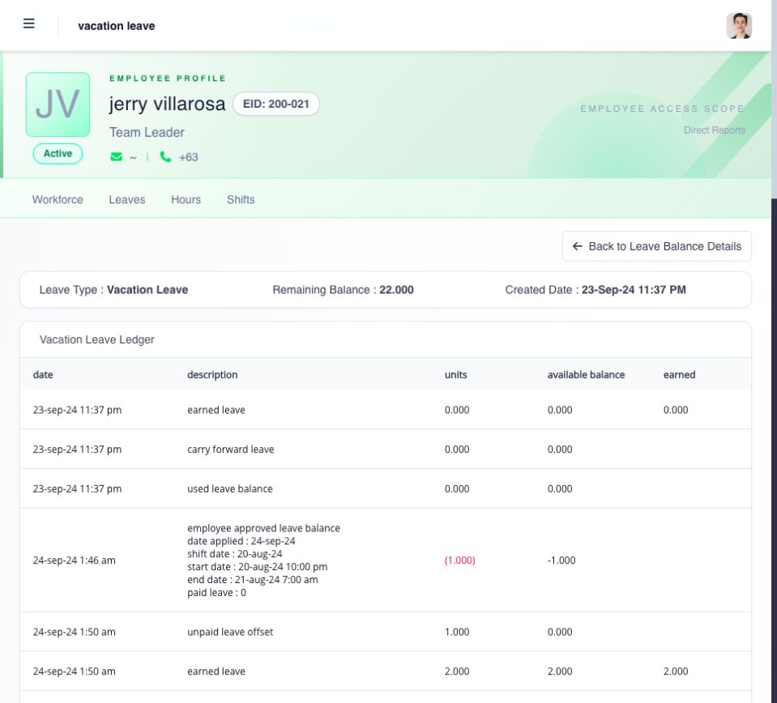

# review an employee's leave, CTO, and balance history

use **Leaves → Leave History** to review requests and approval status. use **Leaves → Leave Balance** to understand the employee's assigned leave and CTO types and the transactions behind each balance.

## choose the record you need

| question                                 | start here                               | then review                                                                                   |
| ---------------------------------------- | ---------------------------------------- | --------------------------------------------------------------------------------------------- |
| was the request approved?                | **Leave History**                        | status, approver levels, action dates, remarks, and attachments                               |
| how much can the employee still request? | **Leave Balance**                        | available and pending amounts for the correct leave type                                      |
| why did the balance change?              | **View Transaction**                     | each earning, reservation, approval, use, return, adjustment, transfer, conversion, or expiry |
| where did CTO come from?                 | the employee's CTO leave type and ledger | source conversion, credit date, expiry date, pending use, and remaining balance               |

## how do i review leave history?

1. open **Leaves → Leave History**.
2. select the employee within your manager scope.
3. filter by status or find the relevant leave type and date.
4. open the request.
5. compare the requested dates and duration with the assigned shift.
6. review the filing date, reason, attachments, approval history, and current status.

**Pending** requests still require a decision. **Approved** requests should match the employee's timesheet and balance. **Rejected** requests do not become approved leave. **Cancelled** requests should show the corresponding return or reversal when credit restoration applies.

## open the employee's balance and ledger

open the employee's record and select **Leaves**. **Leave Balance** lists each assigned type with its units, earned credits, available balance, pending approval amount and next accrual date. **Leave History** below it lists that employee's requests.

select **view transaction** beside the leave type to see the movements behind its balance. check the leave type and remaining balance at the top, then read the dated rows. the ledger distinguishes earned credits, approved use, carry-forward and cancellation, with the source and creator where recorded. scroll across the table for additional columns.

<figure><figcaption>
read the transactions in date order to explain the balance. the current remaining balance appears above the ledger; earlier rows show the balance at that point in time.
</figcaption></figure>

if the team-wide list is empty, first clear filters and confirm your scope. check the employee's individual record before concluding that no leave is assigned. ask the administrator to investigate a difference between the two views.

## how do i explain the balance?

the balance summary is the result of transactions. open **View Transaction** and trace the relevant rows in date order.

| movement                           | usual effect                                                      |
| ---------------------------------- | ----------------------------------------------------------------- |
| earned or assigned credit          | increases the balance                                             |
| pending application                | reserves credit and reduces what is available for another request |
| approved or used leave             | records the accepted use                                          |
| rejection or eligible cancellation | returns reserved or approved credit                               |
| adjustment or transfer             | increases or decreases credit with an authorized reason           |
| expiry                             | removes unused credit that reached its expiry rule                |
| CTO conversion                     | adds time-off credit from eligible approved work                  |

check the leave type, unit, effective date, source, amount, reason, expiry, and balance after the movement. do not explain a balance from the summary alone when the ledger is available.

## what should i check when the employee cannot apply?

confirm that the employee is in your scope and review:

* whether the leave or CTO type is assigned;
* whether the employee has leave entitlement;
* the leave type's effective date;
* the available and pending balance;
* whether the type allows a request beyond available credit;
* overlapping applications;
* required documents; and
* the payroll or application lock shown for the period.

managers cannot change company leave settings merely because the employee is visible. ask an administrator to review assignment or policy setup when the problem is outside your enabled manager actions.

## how do i verify CTO?

CTO is time-off credit created when eligible approved overtime, rest-day work, or holiday work is converted under company rules. it is not ordinary annual leave. review the CTO type's ledger for the credited source, pending reservations, approved use, expiry, and remaining balance.

successfully converted source work is excluded from payroll as that same overtime, rest-day, or holiday work. if the employee expected payment instead of CTO, send the source work date and conversion record to the administrator before changing any balance.

## related articles

* [file leave for an employee](file-leave-for-an-employee.md)
* [correct, adjust, cancel, or delete leave records](correct-adjust-cancel-or-delete-leave-records.md)
* [review requests in To Do](../approvals/review-requests-in-to-do.md)
