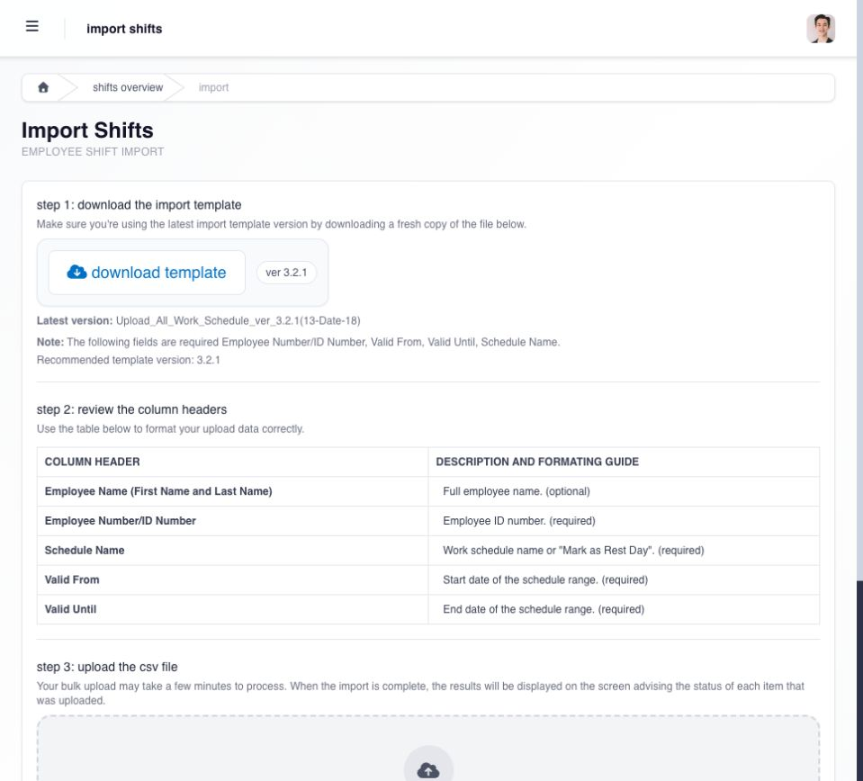

# import or download shift assignments

use import when you have many dated assignments to update. open **Shifts → import file** and download a fresh copy of the template shown on **Import Shifts**.

## prepare and upload the file

| column                                       | what to enter                                                                             |
| -------------------------------------------- | ----------------------------------------------------------------------------------------- |
| **Employee Name (First Name and Last Name)** | employee name; optional, but useful when reviewing your file                              |
| **Employee Number/ID Number**                | required employee ID; use it to identify the intended employee                            |
| **Schedule Name**                            | required work schedule name, or **Mark as Rest Day** when that is the intended assignment |
| **Valid From**                               | required start date for the assignment range                                              |
| **Valid Until**                              | required end date for the assignment range                                                |

1. select **download template**. keep its column headers and follow the date format in that template.
2. prepare the rows for employees in your Manager scope. check IDs, schedule names, dates, rest days and overnight schedules before uploading.
3. save the completed file as CSV, then drag it into the upload area or use **Browse file**.
4. select **upload file** once. processing can take a few minutes; wait for the row results before deciding whether another upload is needed.
5. review accepted and rejected items, correct only the failed rows, and spot-check the employee calendars for the earliest, latest and a representative middle date.

<figure><figcaption>
download the current template and use the required employee ID, schedule name and date-range columns. the CSV upload area follows the column guide.
</figcaption></figure>

an accepted assignment updates the employee's existing shift for the applicable date; it does not create a second active assignment for the same employee and date. use download to capture the current overview for authorized review. keep the validation result with the working file until the imported calendars have been verified.

## read the import result before leaving the page

separate accepted rows from rejected rows. an upload can partially succeed, so the file-level success result does not prove every employee/date changed. retain the validation output until you have corrected rejected rows and confirmed the employee calendars.

common problems include an employee identifier that does not match, an unavailable shift type, an invalid or overlapping date range, an ongoing shift, and a row outside your assigned manager scope. correct only the failed rows before importing them again.
