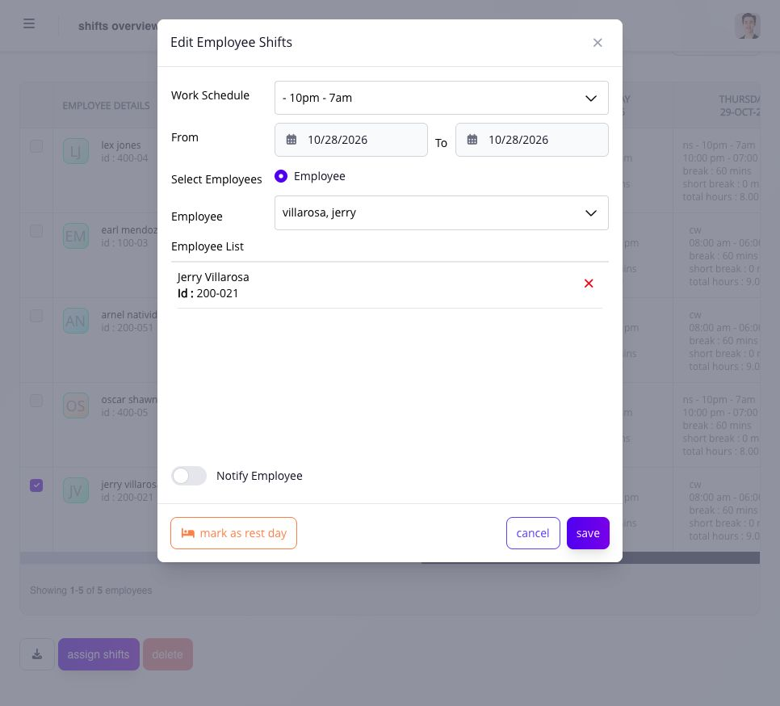

# reassign shifts individually or in bulk

every employee has a default shift. when you assign a different shift for selected dates, it replaces the default or previously assigned shift for those dates. the employee still has a schedule for Ashima to use when interpreting their timesheet.

## assign the replacement shift

1. open **Shifts** and find the employees and week you need.
2. select **assign shifts** to open **Edit Employee Shifts**.
3. choose the replacement **Work Schedule** and its **From** and **To** dates.
4. choose the employee or employees. check **Employee List** inside the form; do not assume a checkbox selected on the overview has already filled this list. remove anyone who should not be included.
5. review the schedule, dates and employee IDs. select **Notify Employee** when you want to use the available notification option.
6. select **save**, then reopen the employee calendar or overview and verify the resulting shift and rest days. use **cancel** to leave without saving.

<figure><figcaption>
check the replacement schedule, dates and Employee List before saving. the same form can select one employee or several employees.
</figcaption></figure>

use **mark as rest day** only when the selected dates should be rest days. a rest day still supplies schedule context; it is not a date with no assigned shift.

do not change an ongoing shift. wait until it ends, or plan the replacement before it starts. a past shift change can affect attendance and payroll-related interpretation, so review the existing timesheet and open payroll before changing historical dates.

if the reassignment is rejected, keep the existing assignment and read the displayed reason. check the employee, date range, replacement shift, ongoing-shift state, and any affected open payroll before trying again. verify every accepted change in the employee calendar; an upload or success message alone is not proof that every selected employee and date was updated.

## choose individual or bulk reassignment

use individual reassignment for one employee or a small date-specific correction. use bulk reassignment when the same replacement shift applies to a defined employee set and date range. in both cases, the new assignment updates the existing shift for each accepted employee/date.

before a bulk change, verify the employee list, dates, replacement shift, rest days, and any overnight boundary. after completion, spot-check the earliest, latest, and a representative middle date, then review employees whose rows were rejected.

## why does a flexible shift overlap another shift?

For a flexible schedule with a latest allowed time-in, Ashima checks the interval from that latest arrival through the configured required hours against the previous and next dated shifts. For example, a latest arrival of 10 a.m. and eight required hours gives an assignment interval ending at 6 p.m. A following shift starting before then can conflict even if the employee intends to arrive earlier.

Changing an attendance log does not change that assigned interval. Review the latest allowed arrival, required hours and adjacent schedules, then correct the authorized schedule or assignment and try again.

Read the employees and dates in any warning before choosing **Continue**, when offered. Continuing rechecks the restriction; it does not bypass it. **Cancel** closes the warning and clears the pending fields, so reopen the assignment form if you want to prepare a different change.

## what can block the change?

an ongoing shift, invalid date range, unavailable shift type, employee outside your scope, payroll state, or conflicting assignment can block the action. keep the current schedule until the displayed problem is resolved.
