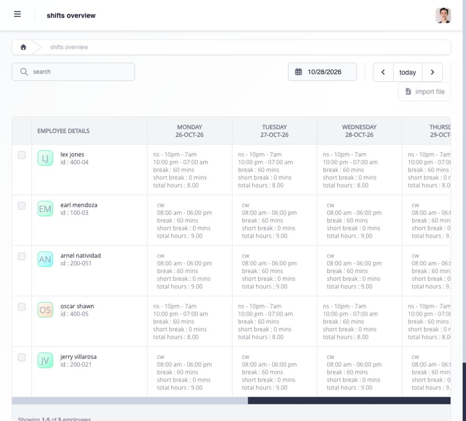

# review team shifts

open **Shifts → Overview** to review schedules for employees in your team scope. filter by the intended period and employee, then open the employee calendar for day-level detail.

a shift supplies the context used to interpret the employee's punches, required breaks, workday or rest-day treatment, leave, attendance, overtime, and payroll-related hours. plan, plot, and assign shifts before they start whenever possible.

<figure><figcaption>
check the employee and work date, then compare the assigned schedule, breaks and total hours. scroll horizontally for the rest of the week.
</figcaption></figure>

managers assign existing shift types. company shift definitions, working hours, breaks, premium-transition rules, and archived status are maintained in the owning Settings and Shifts guidance. see [configure shift rules](../../../admin/settings/time-entry-hours-shifts-and-holidays/configure-shift-rules.md) and [shift types and schedule rules](../../../admin/shifts/configure-and-interpret-shifts/shift-types-and-schedule-rules.md).

if the displayed schedule is wrong, identify the employee, date, current assignment, and expected shift. use the supported reassignment action before the shift starts when possible, then reopen the employee calendar to confirm the change. see [reassign shifts individually or in bulk](reassign-shifts-individually-or-in-bulk.md).

## what should the schedule tell you?

review the shift name, work dates, start and end times, required breaks, rest days, work type, and overnight or premium-transition behavior. the schedule should make sense before employees begin work because it controls how their later punches are interpreted.

check the schedule before approving a timesheet, overtime, rest-day, holiday, or leave request. when the shift is wrong, fix the assignment first and then recalculate or review the affected record.
