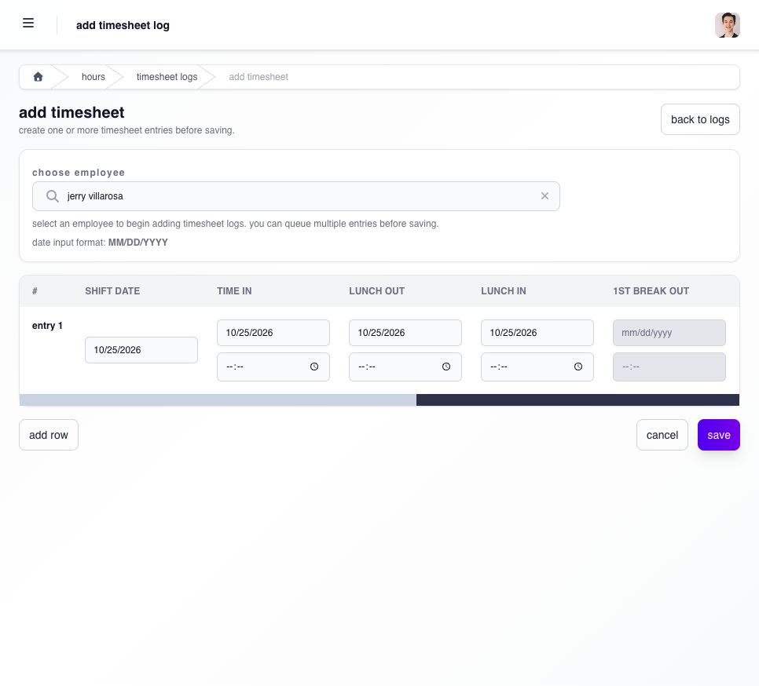
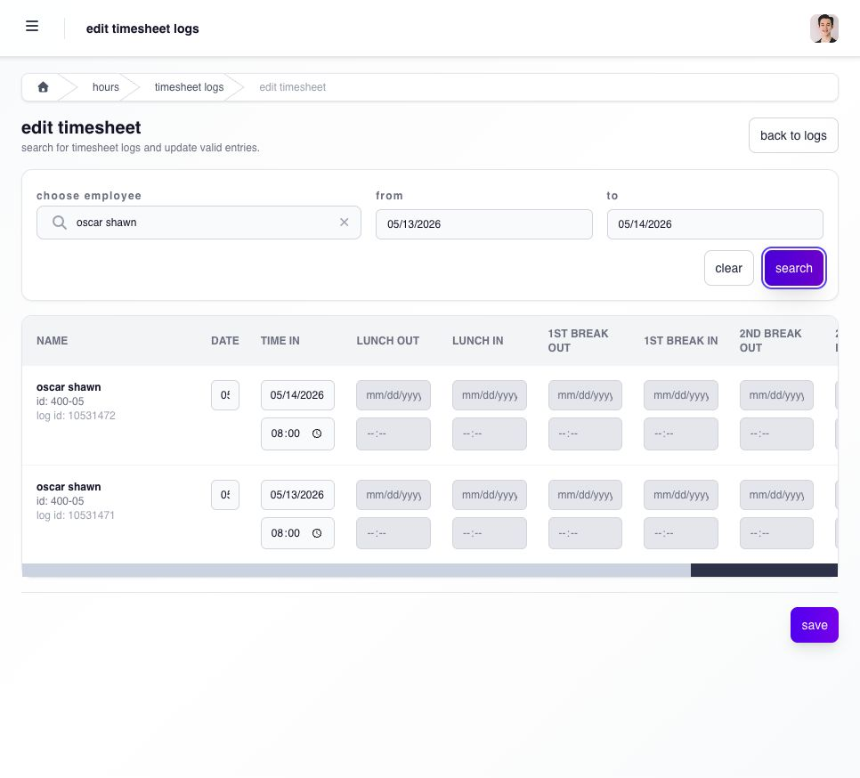

# add or correct a timesheet

use **add** only when the employee has no time record for the intended workday. use **edit** when a timesheet already exists.

**Navigation:** **Hours → Timesheets**. the page heading is **Timesheet Logs**.

your administrator controls which timesheet actions you can use and which employees they apply to. an enabled **add timesheet** or **edit timesheet** action opens its own form. if the action is missing or access is refused, ask the administrator to check your Manager access for that employee; being able to view the row is not enough.

## add a missing timesheet

1. first search the employee and workday in **Timesheet Logs** to avoid adding a duplicate.
2. select **add timesheet**, then choose the employee.
3. set **Shift Date** to the workday you are recording. check that the employee's assigned shift is correct.
4. enter the dates and times for **Time In**, **Time Out**, and the enabled lunch or break punches. scroll the table horizontally to reach the remaining columns. use **MM/DD/YYYY** for dates.
5. for an overnight shift, check each punch's actual calendar date; the clock-out date may be the following day.
6. use **add row** only when another missing entry is needed for the selected employee. remove an unintended row before saving.
7. review all rows, select **save**, then return to **Timesheet Logs** and verify the employee, date, punch sequence and resulting hours.

<figure><figcaption>
choose the employee and workday, then enter the required punches. scroll across the table to reach Time Out and the remaining fields.
</figcaption></figure>

## correct an existing timesheet

1. select **edit timesheet** from **Timesheet Logs**.
2. choose the employee, set **From** and **To**, and select **search**.
3. check the returned workdays and edit only the incorrect date or time in an enabled field. scroll horizontally for later punches.
4. review the whole sequence before selecting **save**. use **back to logs** if no correction is needed.
5. reopen the affected row and check the punches, hours and attendance interpretation.

<figure><figcaption>
search a defined date range before editing. greyed fields are unavailable; scroll right to inspect the rest of each row.
</figcaption></figure>

Ashima also blocks manager timesheet add, edit, and delete actions when payroll updates are frozen for the affected period. if the control is blocked, ask the payroll administrator to review the affected date and the displayed message.

wait until the employee's shift ends before correcting the completed day. editing an ongoing workday can create an incomplete sequence and can be overtaken by the employee's next punch.

see [timesheet logs](../../../admin/hours/timesheets-and-attendance/timesheet-logs.md) for the full administrator interpretation and recovery guidance.

## choose the correct action

| situation                                       | action                                                                                                 |
| ----------------------------------------------- | ------------------------------------------------------------------------------------------------------ |
| no row exists for the workday                   | use **Add** when the page allows it                                                                    |
| the normal row has a missing or incorrect punch | use the supported edit action on that row                                                              |
| the shift is wrong                              | reassign the shift instead of changing punches to fit it                                               |
| the employee worked on a rest day or holiday    | review the required rest-day or holiday application                                                    |
| the date belongs to a closed payroll            | use PPA only when the record is eligible and Ashima presents the action                                |
| the row is **Excess Hours**                     | leave the excess row unchanged; fix its source context because editing excess does not make it payable |

## what validations should i expect?

Ashima can reject an add or correction when the shift is ongoing, the date is in the future, the time sequence is invalid, a required punch is missing, another request already covers the record, payroll is frozen, or the closed-payroll date is outside PPA rules.

after saving, verify the time sequence, actual and regular hours, attendance exceptions, request status, and affected payroll. do not treat a success message alone as the completed result.
