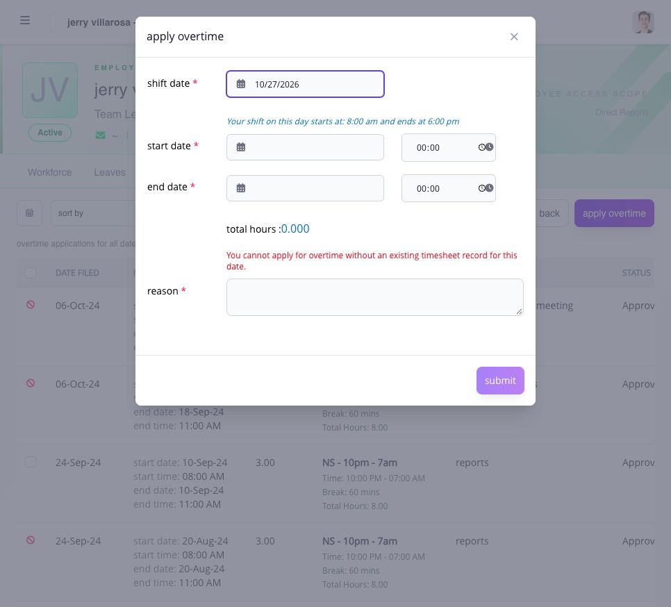

# file overtime for an employee

open the employee's overtime record when your Manager access includes **apply overtime**. the team-wide **Hours → Overtimes** page is the history list; the application form is on the individual employee record.


**filing also approves the overtime:** when your Manager access allows you to file for the employee, a successful submission is recorded as **Approved**. it does not wait for another approver in To Do. review the worked period and hours before submitting, then check the saved result.


## enter the overtime worked

1. confirm the employee name and ID, then select **apply overtime**.
2. choose **shift date** and check the shift start and end times returned by Ashima.
3. enter the overtime **start date**, **end date**, and their times. check the calendar dates carefully when work crosses midnight.
4. review **total hours** and enter the **reason** for the overtime.
5. resolve any displayed validation message, then select **submit** once.
6. return to the employee's overtime history and verify the saved period, hours, reason and status.

<figure><figcaption>
choose the shift date first. Ashima shows the schedule and blocks the application when that date has no timesheet record.
</figcaption></figure>


**no timesheet for the selected date:** when the form says **You cannot apply for overtime without an existing timesheet record for this date.**, check the workday and correct or complete the timesheet first. changing the overtime period does not create missing punches.


approval still does not guarantee the requested amount will be paid: payroll uses the eligible worked hours and configured rules. deleting an overtime application is a separate assigned action.

if the application cannot be submitted, check the employee, overtime date, assigned shift, requested hours, your assigned action, and whether payroll is locked. correct the field identified by the page. ask the administrator to review the employee's eligibility, workflow, or payroll state when the action remains unavailable.

## requested time and payable overtime can differ

Ashima applies the employee's overtime entitlement, assigned shift, actual punches, day classification, approval, grace period, minimum duration, cap, and pre-shift rule. filing a 90-minute request does not guarantee 90 payable minutes.

correct a missing or incorrect timesheet before filing overtime. an overtime request does not create the employee's missing punches.

## track the request

open the overtime list and review the request status and approver progress. **Pending** is still waiting for a decision. **Approved** makes the eligible record available to the applicable payroll treatment. **Rejected** stops the request. approval does not rewrite a closed payroll; use PPA only when the source date and company settings allow it.
