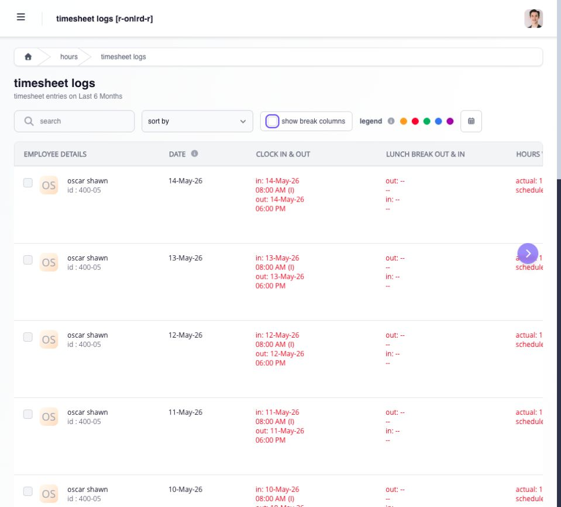
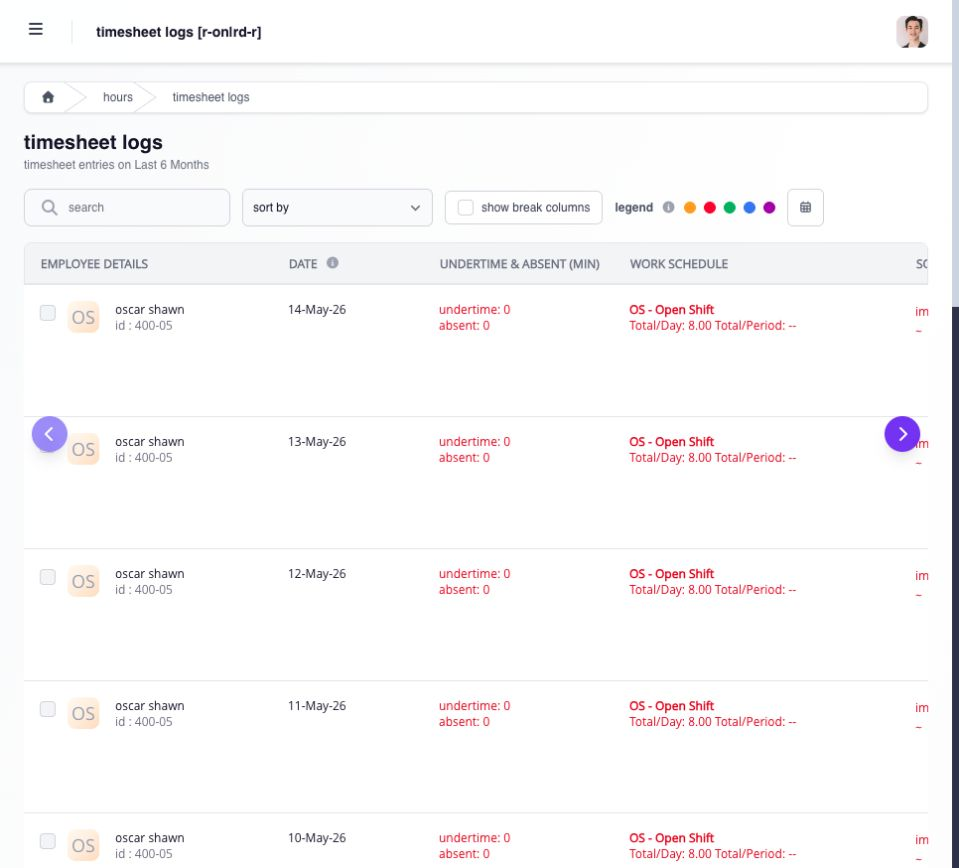

# review team timesheets

open **Hours → Timesheets** (the page heading is **Timesheet Logs**), choose the relevant date or period, and find the employee. open the employee detail when you need to compare the assigned shift, captured punches, status, and hours.

review the record in this order:

1. confirm the employee and work date.
2. check the assigned shift, including required lunch or break punches.
3. compare the time in, time out, and required intermediate punches.
4. review attendance results and total hours.
5. check related leave, overtime, or request history when the result needs explanation.

the timesheet records punches. the shift provides the schedule context Ashima uses to interpret those punches. if the shift is wrong, reassign the correct shift; do not reshape the punches merely to make them fit the wrong schedule.

use **show break columns** to inspect the intermediate break punches and the table arrows to reach hours, attendance results, work schedule and source columns. keep the employee and date in view as you move across the row.

<figure><figcaption>
compare the punches for the same employee and date. use the table arrows to inspect columns farther to the right.
</figcaption></figure>

use download when you need an authorized copy of the filtered data. a download is a snapshot and does not replace the current record in Ashima.

## what should i review before changing anything?

use this sequence so one correction does not hide another problem:

| layer          | question                                                                                                          |
| -------------- | ----------------------------------------------------------------------------------------------------------------- |
| shift          | is the correct schedule assigned for the work date?                                                               |
| punches        | are the required time in, time out, lunch, and additional break entries present?                                  |
| interpretation | do late, overbreak, undertime, absence, actual hours, and regular hours follow from that shift and those punches? |
| applications   | is a shift change, timesheet adjustment, leave, overtime, rest-day, holiday, or PPA request pending?              |
| payroll        | is the related payroll open, frozen, waiting for approval, or closed?                                             |

## what do common exceptions mean?

* **Tardiness** compares the recognized time in with the shift start and company rules.
* **Overbreak** is tracked break time beyond the duration allowed by the shift.
* **Undertime** is scheduled work not completed under the applicable rule.
* **Missing Punch** means the shift expects a punch that is absent.
* **Excess Hours** is an unmatched captured entry. it remains visible for traceability but is excluded from actual, regular, and payable hours. do not edit the excess row to make it payable; correct the shift, normal timesheet, or applicable request that caused the mismatch.

<figure><figcaption>
the same rows show attendance results and the assigned work schedule farther across the table. these columns help explain how the punches were interpreted.
</figcaption></figure>

## what should happen after a correction?

reopen the employee timesheet, confirm the accepted punches and attendance result, review any approval status, and recalculate an affected open payroll when required. a corrected timesheet does not rewrite a closed payroll.
