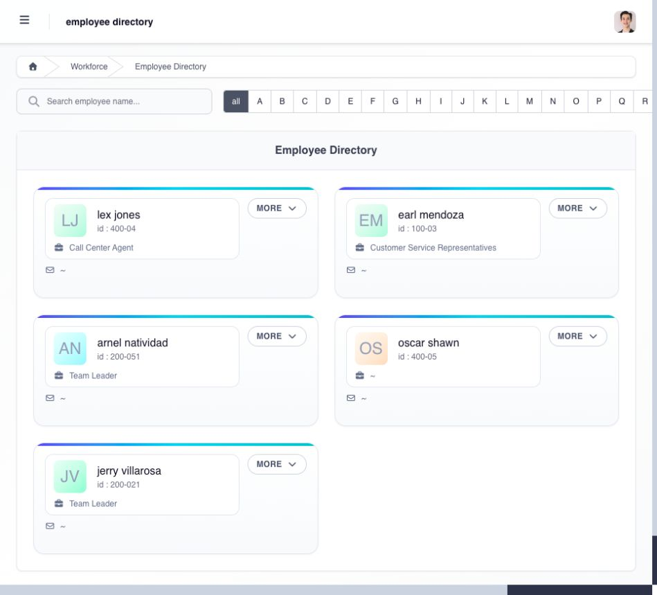

# find an employee in Workforce

use **Workforce** as the starting point for employee records within your assigned team.

| page                   | use it when                                                                                                         |
| ---------------------- | ------------------------------------------------------------------------------------------------------------------- |
| **Employee Directory** | you need to find an employee and open the available profile sections                                                |
| **Personal Details**   | you need contact, emergency, dependent, or other personal information made available to you                         |
| **Employment Details** | you need job, department, reporting, status, government-ID, or employment-history information made available to you |
| **Government Loans**   | you need to review or maintain an employee's government loan when the action is assigned                            |
| **Third-Party Loans**  | you need to review or maintain a company or third-party loan and its amortization when assigned                     |

## how do i use the employee directory?

1. open **Workforce → Employee Directory**.
2. enter the employee's name in the search field or use the alphabet filter.
3. check the employee's name and ID on the card.
4. select **MORE** to expand the card's details, including employment status, hire date, position, and **Reports To**. select **LESS** to collapse it again.

<figure><figcaption>
find the employee by name and ID, then select MORE to review the details on the card.
</figcaption></figure>

use **Workforce → Personal Details** or **Employment Details** for the corresponding team records. when a page offers a download, use it only for information you are authorized to handle and protect the exported file according to company policy.

if an employee is missing, ask the administrator to check the employee's active company, **Reports To** relationship, department, and your Manager Access Settings. do not work around a missing employee by using another person's account.

## why might the employee be missing?

an employee can be outside your result because the selected company is wrong, the employee is inactive or assigned elsewhere, the **Reports To** relationship does not point to you, the employee's department is outside your scope, or the administrator did not enable Workforce access for that scope.

use the exact employee identifier when names are similar. if the employee appears on one page but not another, report both page names because page visibility and task permissions are separate.
