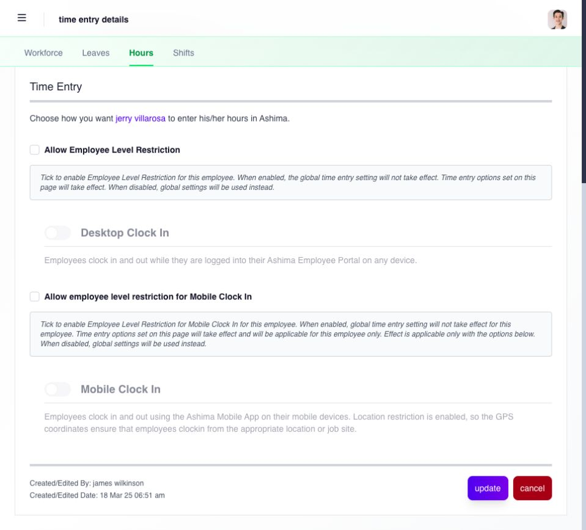

# manage employee time-entry access

use the employee's **Time Entry** record only when your assigned Manager access includes it. the page can control employee-specific clocking behavior such as whether timesheets are required, desktop or mobile photo capture, an individual desktop IP restriction, mobile authentication, geofencing, and allowed IP addresses.

these controls affect whether and how the employee can add punches; they do not create a shift or correct an existing timesheet.

| control               | practical effect                                                                |
| --------------------- | ------------------------------------------------------------------------------- |
| timesheet required    | determines whether the employee is expected to produce time records             |
| desktop photo capture | requires or allows a photo for desktop punches according to the saved setting   |
| individual desktop IP | limits desktop clocking to the employee-specific allowed network when enabled   |
| mobile photo capture  | requires or allows a photo for mobile punches according to the saved setting    |
| mobile authenticator  | controls the employee-specific mobile authentication requirement                |
| geofencing            | applies the employee's allowed-location requirement for mobile clocking         |
| IP address list       | defines employee-specific network addresses used by the applicable desktop rule |

## check whether company or employee settings apply

**Allow Employee Level Restriction** determines whether the employee-specific desktop options on this page apply. when it is off, the company settings apply instead. **Allow employee level restriction for Mobile Clock In** separately controls the displayed mobile options.

select **edit** only when you are authorized to change the employee's time-entry setup. review the applicable override and its options, then use **update** to save or **cancel** to leave unchanged. a greyed method under a disabled employee override does not by itself mean the company has disabled that method.

<figure><figcaption>
check which settings apply before changing a clocking method. company settings remain relevant when the employee-level override is off.
</figcaption></figure>

before changing a control, confirm the company's time-entry policy, the employee's workplace, and the company-level setup. after saving, ask the employee to verify the clock from the intended device and network. see [choose employee time-entry options](../../../admin/settings/time-entry-hours-shifts-and-holidays/choose-employee-time-entry-options.md) for the complete setting relationships.

## add or change an allowed IP address

When your Manager permissions allow this action, use **Add Static IP Address** to enter one IPv4 address, an inclusive **From–To** range, or a three-octet subnet. A range allows every address between its endpoints; check the displayed address count before confirming. Location is optional when adding a rule, including when no company location has been configured.

To edit a saved employee IP rule, open its row and complete both the location and description required by the edit form before saving. To remove rules, select only the intended rows and confirm **Delete**. Check the refreshed list afterward.

Correct reversed ranges, non-IPv4 values and overlaps with rules in the same scope before retrying. After saving, verify clock access from the intended network; adding a rule does not change the company-versus-employee restriction switch.

## troubleshoot without weakening the rule

when the employee cannot see or use a clock, confirm the enabled method, current network or location, saved IP or geofence, photo or authenticator requirement, and company-level setting. do not disable a security or location rule solely to make one test pass. correct the employee-specific value or ask the administrator to review the company setting.
