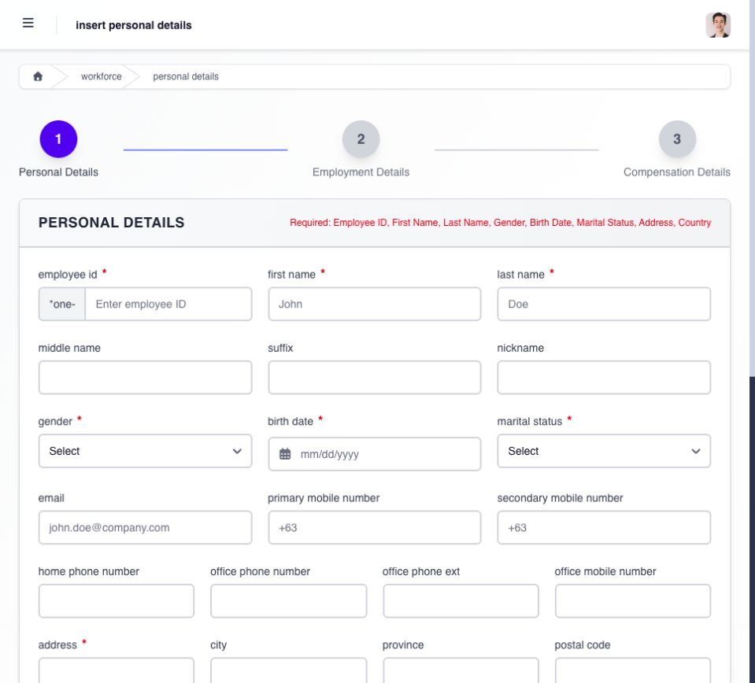

# onboard an employee when the action is assigned to you

when **add employee** access is assigned, Manager portal can expose the onboarding sequence for personal details, employment information, and compensation.

start from **Workforce → Personal Details → + new**. the form shows three stages: **Personal Details**, **Employment Details**, and **Compensation Details**.

**Personal Details** requires the employee ID, first and last name, gender, birth date, marital status, address and country. check the company prefix shown beside the employee ID. use confirmed information rather than the sample text in empty fields. enter optional contact details and dependents when available, then use **next: employment details** to continue.

<figure><figcaption>
start with the employee identity and required personal details. the progress indicator shows the employment and compensation stages that follow.
</figcaption></figure>

## complete the onboarding sequence

1. start the employee record and complete the required personal information.
2. add dependents and contact details only from confirmed records.
3. complete employment information, including company, department, position, status, dates, **Reports To**, and the required workflow assignments.
4. complete compensation and statutory contribution information from the approved employment package.
5. review every stage before saving or continuing.
6. open the finished employee record and confirm the saved information.

do not guess compensation, government identifiers, contribution treatment, reporting relationships, or effective dates. these fields can affect access, statutory records, timekeeping, and payroll. if your role is limited to collecting part of the onboarding information, stop at the supported handoff and ask the responsible administrator to complete the remaining stages.

## verify the employee can begin using Ashima

a saved profile is only one part of onboarding. confirm the intended employment status and dates, **Reports To**, department, payroll group and compensation handoff, leave and shift assignment, employee account access, and required Workflow assignments. the responsible administrator must complete any stage outside your manager access.
