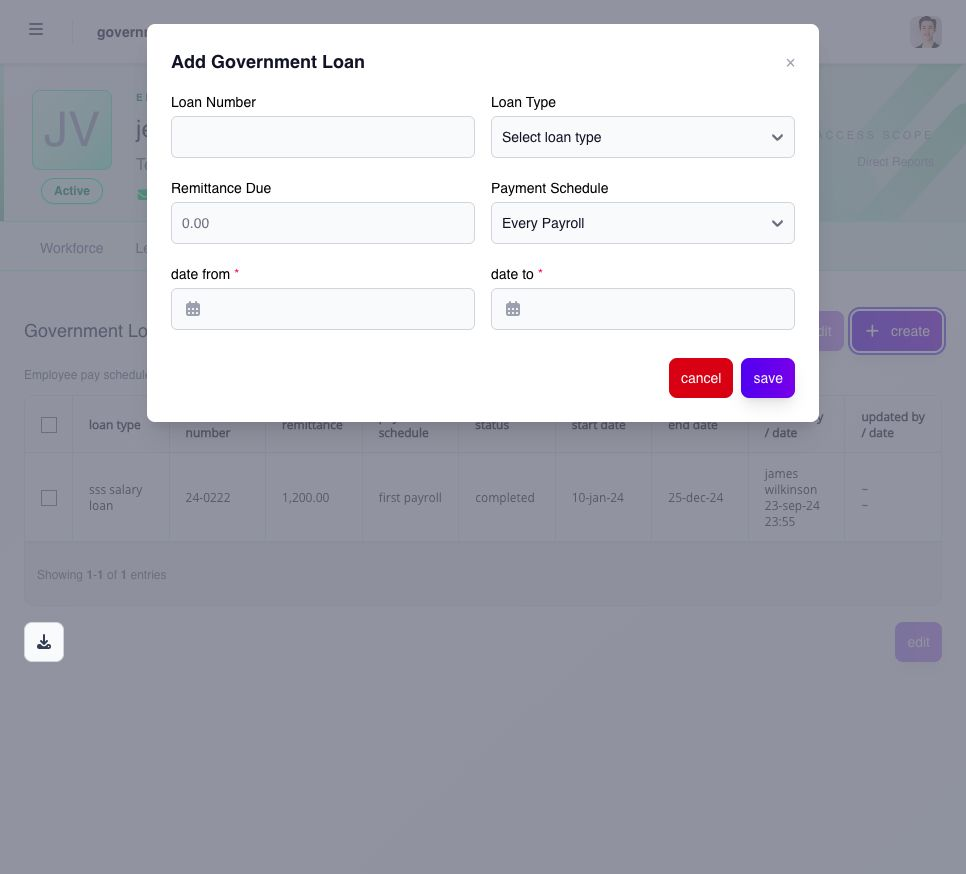
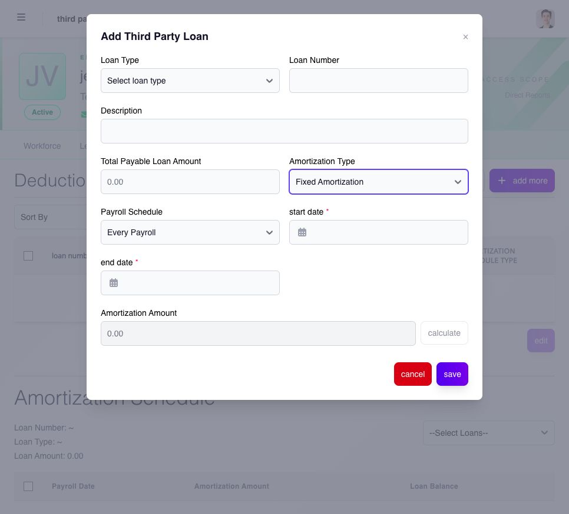

# review and maintain employee loans

Manager portal can expose **Government Loans** and **Third-Party Loans** when the functions are assigned to you. use the list to find the employee, open the loan detail, and confirm the loan type, reference, principal or balance, amortization, pay schedule, start or effective dates, and current status.

## government loan assignment

open the employee's **Government Loans** detail and check the displayed pay schedule. **create** opens **Add Government Loan**.

* **Loan Number** identifies the approved loan record.
* **Loan Type** selects the configured government loan.
* **Remittance Due** records the approved deduction amount for the assignment.
* **Payment Schedule** selects the first, second, last, or every payroll option available for the employee.
* **date from** and **date to** define the assignment period.

review these values against the approved loan instructions, select **save**, then check the new row's amount, schedule, dates and status. do not create another assignment when the intended loan already exists.

<figure><figcaption>
use the approved loan reference, remittance amount, deduction schedule and dates.
</figcaption></figure>

## third-party loan assignment

on the employee's third-party loan detail, **add more** opens **Add Third Party Loan**. choose the configured **Loan Type**, enter **Loan Number**, **Description**, and **Total Payable Loan Amount**, then select **Amortization Type**.

* **Manually Imported/Added** uses the supported separately maintained amortization schedule.
* **Fixed Amortization** displays **Payroll Schedule**, start and end dates, and **calculate**. review the resulting **Amortization Amount** before saving.

if **Loan Type** has no selectable item, ask the administrator to check the available company loan definitions; do not substitute another type. after saving a valid loan, select it in **Amortization Schedule** and review payroll dates, installment amounts and the loan balance. use custom schedule controls only when assigned and appropriate to the loan.

<figure><figcaption>
Fixed Amortization adds the payroll schedule and date range used to calculate the installment. select a valid loan type before completing the assignment.
</figcaption></figure>

## check a new or changed loan

when you are allowed to add or change a loan:

1. select the correct employee and applicable loan type.
2. confirm the employee's pay schedule.
3. enter the approved loan and amortization details.
4. review the calculated or custom amortization when the page provides it.
5. save and reopen the loan detail.

deleting a loan or amortization can change future deductions. confirm whether payroll has already consumed the record before editing or deleting it. use the complete Settings guidance for [government loans](../../../admin/settings/deductions-and-loans/configure-government-loans.md) and [third-party loans](../../../admin/settings/deductions-and-loans/configure-third-party-loans.md) to understand the company item before assigning it to an employee.

## what should i check against payroll?

confirm the loan's effective date, pay schedule, amortization, remaining balance, and status against the payroll period that should deduct it. an assignment can exist without appearing in an earlier or ineligible payroll. after an authorized update, ask payroll to recalculate an affected open pay run when required.
