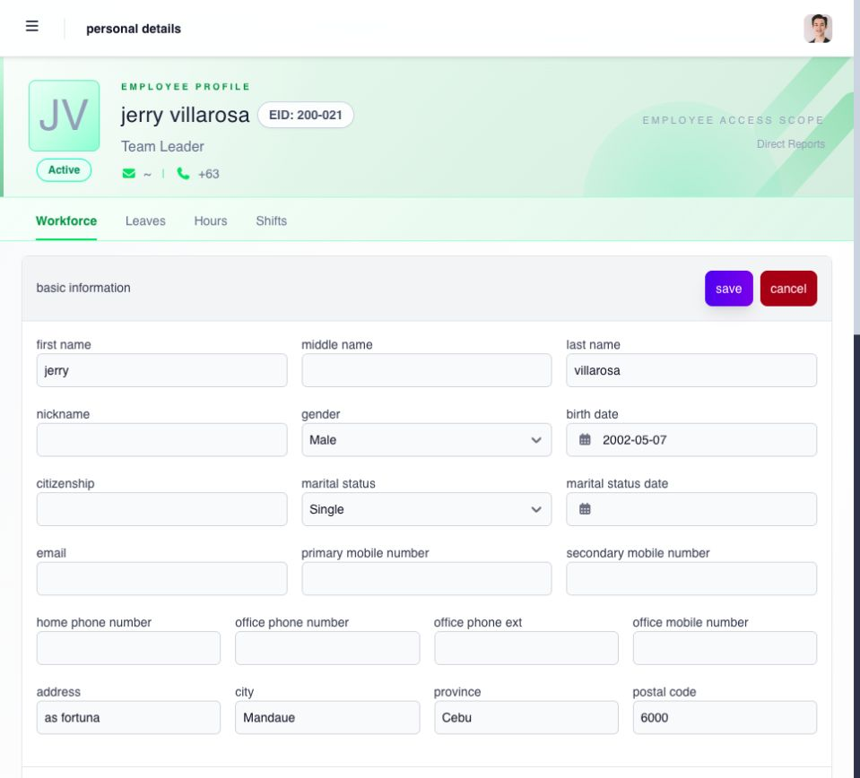
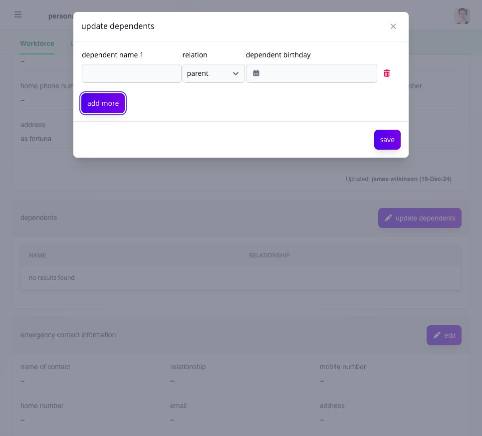
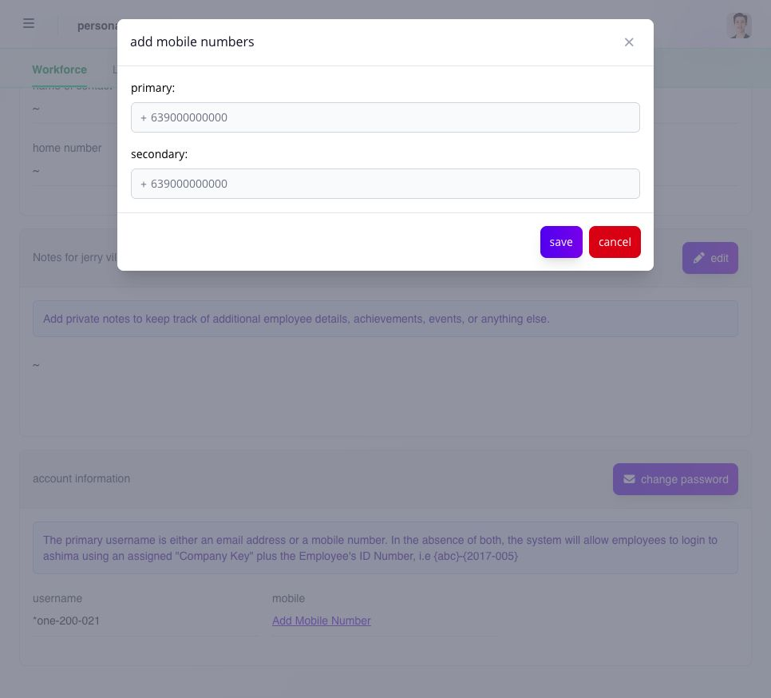

# review and update employee personal details

open **Workforce → Personal Details**, select the employee, and use only the sections and actions displayed for you. depending on your assigned access, the record can include basic information, notes, emergency contacts, dependents, and mobile numbers.

## choose the section to update

| section                                     | action and fields                                                                                                                                         |
| ------------------------------------------- | --------------------------------------------------------------------------------------------------------------------------------------------------------- |
| **basic information**                       | select **edit** to maintain permitted name, birth, marital, contact and address fields; **save** applies the changes and **cancel** leaves them unchanged |
| **dependents**                              | select **update dependents**, then **add more** for a new row; enter the name, relationship and birthday before saving                                    |
| **emergency contact information**           | use its own **edit** action for the contact person, relationship, phone, email and address                                                                |
| **Notes**                                   | use the section's **edit** action for relevant employee notes; this does not change structured personal or employment fields                              |
| **account information → Add Mobile Number** | enter the intended primary and secondary mobile numbers, following the format shown                                                                       |

<figure><figcaption>
the Manager edit form can expose more fields than Employee self-service. change only the details you are authorized to maintain.
</figcaption></figure>

<figure><figcaption>
add a row for each dependent and check the relationship and birthday before saving.
</figcaption></figure>

<figure><figcaption>
check which number should be primary. use the format displayed in the form.
</figcaption></figure>

## verify and save the change

before saving:

1. confirm the employee and company;
2. verify the change with the employee or an authorized source;
3. update only the intended field or record;
4. review names, dates, contact information, and relationships; and
5. save, then reopen or refresh the record to confirm the result.

changing the primary mobile number affects which saved number is treated as the employee's main contact. do not replace a number merely because another number exists; confirm which one should be primary.

> **privacy:** open and change personal information only when it is required for your assigned work. do not place sensitive information in free-text notes when a designated field or company process exists.

## what should happen after saving?

reopen the same section and verify the new value, updater information when shown, and the intended primary contact. if the page saved one field but another dependent display remains unchanged, stop and ask the administrator to review the owning record rather than repeating the update.
