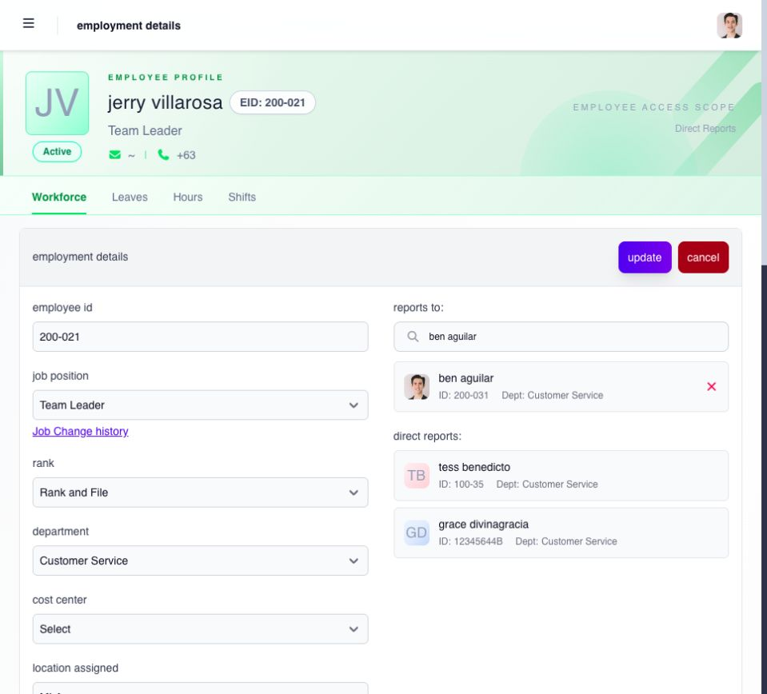

# review and update employment details

open **Workforce → Employment Details** and select the employee. the available record can include department, position, employment type, status, **Reports To**, government IDs, job history, employment-type history, and workflow assignments.

## review or correct the record

1. confirm the employee name, ID and access scope at the top of the record.
2. read the current employment details. use **Job Change history** and **Employment Type Change History** when you need to understand earlier changes.
3. if an authorized correction is needed and **edit** is available, open it and change only the intended fields. the form can include employee ID, position, rank, department, cost center, location, project, employment type, hire date and **Reports To**.
4. check the selected reporting manager and any effective-date or history information requested by the relevant action.
5. select **update**, then reopen the record to verify the result. choose **cancel** if the correction is not ready.

**government-issued identification** has a separate **edit** action. do not change an identifier while making an unrelated employment correction.

<figure><figcaption>
verify the employee and reporting manager before updating. changes to department or Reports To can affect who can see the employee.
</figcaption></figure>

## understand the effect before saving

treat the following as high-impact changes:

* **Reports To** can change who sees the employee through Direct Reports scope and can affect manager workflow setup.
* department changes can change which department-scoped managers can see the employee.
* employment status and dates can affect employee access and downstream workforce or payroll processing.
* government identifiers are used by statutory and payroll processes.
* workflow reassignment changes who receives future requests covered by that workflow.

review the effective date and the intended current value before saving. when Ashima previews default My Team Access for a newly selected reporting manager, read the confirmation before proceeding. saving a reporting relationship and generating manager access are related controls; they are not a reason to grant broader access than the manager needs.

after saving, reopen the employee record and confirm the value and effective date. if a related employee, workflow, or Manager portal result is wrong, stop making additional changes and give the administrator the employee, field, old value, new value, effective date, and result that needs review.

see [maintain employee employment details](../../../admin/workforce/employee-records/maintain-employee-employment-details.md) and [configure manager and Admin My Team access](../../../admin/settings/platform-controls/configure-manager-and-admin-my-team-access.md) for the owning administrator guidance.

## review downstream effects

an effective employment change can alter manager scope, workflow routing, leave entitlement, time-entry availability, and payroll eligibility. after a high-impact update, verify the employee directory, manager relationship, expected workflow owner, and applicable open payroll before treating the work as complete.

## why can’t i edit or delete a PMS decision in history?

A **PMS decision** row records an outcome from a performance evaluation. It is read-only in employment history: it does not open the manual history editor and cannot be selected for deletion, even when its effective date is in the future. Use the owning performance-evaluation process to investigate that decision.

For a manual job or employment-type change, use its separate action, enter the effective date and required details, save, and check the reloaded history. Only future-effective records that offer deletion can be selected for that action; a future date alone does not make every history row deletable.
